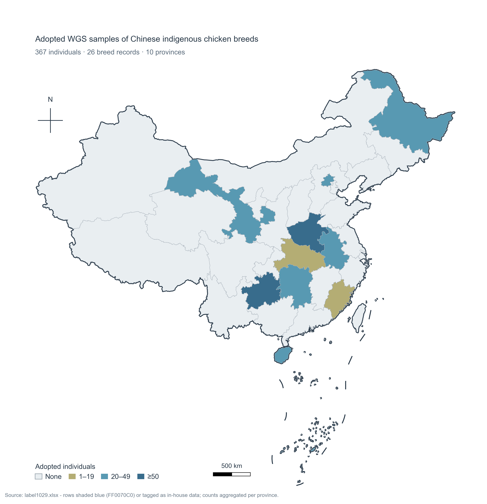
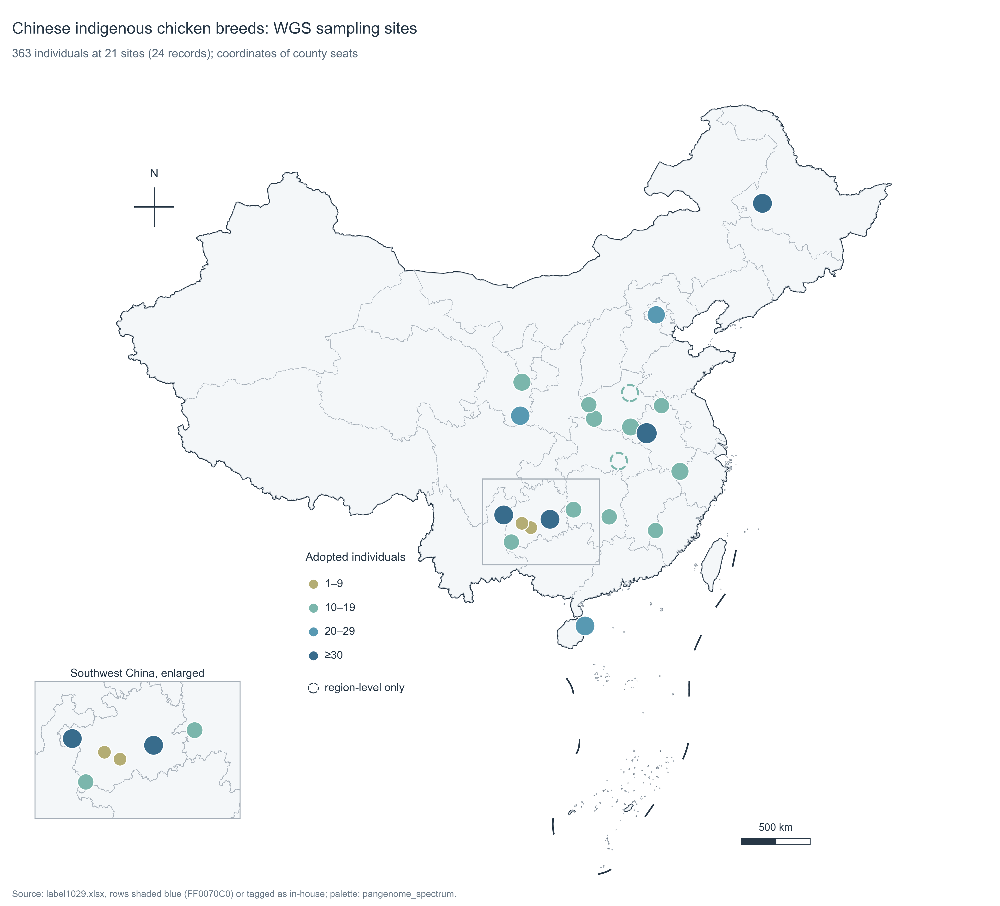

# China sampling — adopted WGS individuals, province and point level

Where the adopted whole-genome-sequencing samples of Chinese indigenous chicken
breeds come from. Two views of the same table:

* **province choropleth** (`fig1_province_counts.*`) — four-class fill, MaxEnt-map
  visual language;
* **point map** (`fig2_sampling_sites.*`) — every collection site plotted at its
  county/city coordinates, English-only, **no text on the map** (journal style: the
  site list belongs in the caption or a table), plus a small zoom inset for the
  crowded southwest cluster.





## Data provenance

Source workbook: `label1029.xlsx` (research workspace, **not** committed here).

Selection rule, as specified by the project owner:

1. rows whose summary-sheet marker is shaded blue (`FF0070C0`), **or**
2. rows tagged as in-house data.

That yields **26 blue rows**. Two of them are duplicate re-uploads of earlier rows
(rows 58 and 62), so **both** figures use **24 records → 21 sites → 363 individuals**.
The earlier 367-individual version of the province map counted those duplicates and
must not be cited.

| Province | Individuals | Records |
|---|---:|---:|
| Henan | 93 | 8 |
| Guizhou | 74 | 5 |
| Gansu | 46 | 2 |
| Heilongjiang | 30 | 1 |
| Anhui | 29 | 2 |
| Hainan | 29 | 1 |
| Hunan | 22 | 2 |
| Beijing | 20 | 1 |
| Fujian | 10 | 1 |
| Hubei | 10 | 1 |

Class breaks: province map `1–19 / 20–49 / ≥50`; point map `1–9 / 10–19 / 20–29 / ≥30`.

## Coordinates

`china_sampling_sites.tsv` carries one row per collection site:

| column | meaning |
|---|---|
| `lon`, `lat` | coordinate of the county / city government seat (DataV GeoAtlas `center`), or the representative point of a named production region |
| `precision` | `county`, `city`, `prefecture`, `region` — `region` rows are drawn as **dashed rings** because the record is only at “Jianghan Plain” / “Central Plains” level |
| `dx`, `dy` | label offset in degrees, hand-tuned so the 21 numbers do not collide |
| `individuals`, `records` | adopted individuals and how many blue rows were merged into this site |

Merged duplicates: Xichuan black-bone (2 rows), Zhengyang three-yellow (2),
Gushi (2). Duplicate re-uploads dropped: Qiandongnan small-fragrant row 58,
Weining row 62.

Sites whose record is only region-level:

| id | breed | placed at | reason |
|---|---|---|---|
| 15 | Henan game | Kaifeng 114.34 E, 34.80 N | record says only “Henan, Central Plains game-fowl area” |
| 19 | Jianghan | Xiantao 113.45 E, 30.36 N | record says only “Hubei, Jianghan Plain” |
| 7 | Qiandongnan small-fragrant | Kaili 107.98 E, 26.58 N | prefecture-level record |

## Captions

Ready-to-paste captions (Chinese + English) are in [CAPTIONS.md](CAPTIONS.md).

## Files

| Path | Role |
|---|---|
| `CAPTIONS.md` | Figure captions, Chinese (thesis) and English (journal) |
| `china_sampling_counts.tsv` | Province aggregates — input of the choropleth |
| `china_sampling_sites.tsv` | Site coordinates + short place label + label offset — input of the point map |
| `plot_china_sampling_map.py` | Choropleth renderer (matplotlib + GeoJSON) |
| `plot_china_sampling_points.py` | Point-map renderer (same stack, plus zoom inset) |
| `data/*.geojson` | Boundary inputs (see *Boundary data*) |
| `fig1_province_counts.png/.pdf` | Province map (English) |
| `fig2_sampling_sites.png/.pdf` | Point map (English, no on-map text) |

## Usage

```bash
python3 plot_china_sampling_map.py --lang en      # -> fig1_province_counts.*

python3 plot_china_sampling_points.py             # -> fig2_sampling_sites.*
python3 plot_china_sampling_points.py --labels    # draft with place names
```

Options: `--counts` / `--sites`, `--geo`, `--maritime`, `--outdir`, `--stem`.
Edit the TSV and re-run; label offsets live in the same file.

## Boundary data

* `data/china_provinces.geojson` — province polygons from the Alibaba DataV
  GeoAtlas service (`100000_full.json`, AMap-derived); its `100000_JD` feature is
  the nine-dash line and is drawn separately.
* `data/china_maritime.geojson` — maritime boundary as `MultiLineString`, from
  [cnmetlab/cnmaps-data](https://github.com/cnmetlab/cnmaps-data).

`data/` is git-ignored, so fetch both after cloning:

```bash
mkdir -p data && cd data
curl -Lo china_provinces.geojson \
  https://geo.datav.aliyun.com/areas_v3/bound/100000_full.json
curl -Lo china_maritime.geojson \
  https://raw.githubusercontent.com/cnmetlab/cnmaps-data/main/cnmaps_data/data/datasets/administrative/amap/maritime/100000.geojson
```

For journal submission inside China, replace them with the standard map service
boundary (`bzdt.ch.mnr.gov.cn`) and print its map approval number.

## Style notes

* Province map 149 × 154 mm, point map 189 × 156 mm; white background, no grid,
  no gradients or shadows.
* Text 5.5–7 pt, Arial/Helvetica with Liberation Sans and DejaVu Sans fallback;
  no CJK fonts, so the PDFs embed cleanly on any machine.
* Point map uses the house palette from
  [1577377232/Genomics-Figure-Styles](https://github.com/1577377232/Genomics-Figure-Styles)
  (`palettes.json` → `pangenome_spectrum`, the theme's default):
  class ramp `#B4AD74 → #7BB6AC → #5899B2 → #386C8C` (four steps of the six-colour
  cycle, ordered light → dark), text/border `#273746`, province lines `#A9B2BB`.
  No invented colours; the choropleth keeps the MaxEnt ramp because it mirrors the
  reference figure it reproduces.
* Marker colour and area both encode the individual count (redundant encoding);
  `region`-level records get a dashed ring.
* No place/breed text is drawn on the map — published maps of this kind carry the
  site list in the caption. `--labels` adds the 2–3 character place names for
  internal drafts only; the submitted figure runs without it.
* Land fill is a very light neutral (`#F4F7F9`) so the country reads as a shape
  without competing with the markers; sea stays white.
* National border is a thick stroke under the fills (the fill covers its inner
  half), so border and fill share one vector path and can never misregister.
* The southwest cluster gets a zoom inset (`103.4–111.0 E, 24.1–28.6 N`) with the
  extent boxed on the main map; its numbers are moved into the inset only.
* Export: PNG 600 dpi + vector PDF with editable text (`pdf.fonttype = 42`).

## Privacy

Only aggregates and site coordinates are committed — no accession IDs, no sample
metadata, no sequencing data. The source workbook stays in the research workspace.
