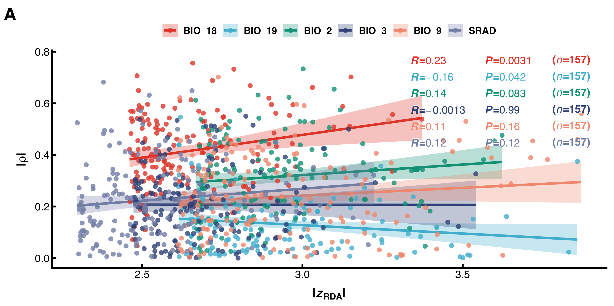

# Method-agreement scatter: one regression per environmental variable

A single panel in the layout of Figure 4A of Yuan et al. (2026, *Zoological
Research*): points are genomic windows (or loci) coloured by environmental
variable, each colour carries its own linear fit with a 95% confidence band,
and the `R`, `P` and `(n)` of every fit are printed on the right in the matching
colour.



## What the panel shows

* **x** — evidence from screen 1 (in the paper: standardized F<sub>ST</sub> of a
  50 kb window).
* **y** — evidence from screen 2 (in the paper: |s<sub>XP-EHH</sub>| averaged
  over the same window).
* **colour** — the environmental variable the windows were selected for; one
  linear fit and one 95 % confidence band per colour.
* **right-hand block** — Pearson `R`, its `P`, and the number of points in that
  colour, formatted with `signif(x, 2)`, exactly as in the reference panel.
* The legend keys show the filled band, the regression line and the point in one
  square: that is what ggplot2 draws by itself once `colour` and `fill` are
  mapped to the same variable and the two guides are merged with the same
  `nrow`/`ncol`.

## Input

Tab-separated, one row per point, header required:

| column | meaning |
|---|---|
| `group` | environmental variable; used verbatim in the legend and in the `R / P / n` block |
| `x` | value of screen 1 |
| `y` | value of screen 2 |

`n`, `R` and `P` are computed by the script; they are never typed in by hand.
The same numbers are also written to `<stem>_stats.tsv`, so the figure and the
manuscript table can be checked against each other.

## Run

```bash
Rscript plot_corr_ci_panel.R \
  --input te_method_corr.tsv \
  --out corr_ci_scatter \
  --xlab '~bold("|"*italic(z)[RDA]*"|")' \
  --ylab '~bold("|"*rho*"|")'
```

`--xlab` / `--ylab` take plain text by default; a leading `~` passes the rest to
`plotmath`, which is how the subscripts and the vertical bars in the axis titles
are produced.

## Options worth knowing

| option | default | note |
|---|---|---|
| `--palette` | `npg` | `npg` is the six-colour set used by the reference panel (`#E64B35 #4DBBD5 #00A087 #3C5488 #F39B7F #8491B4`). `pangenome_spectrum`, `chromatic_nc`, `botanical_genome` come from `figure-style/style/palettes.json`; `greys` is the press-safe fallback |
| `--base-size` | 6 | everything else scales from it (ticks −0.5 pt, legend −1 pt, annotation −0.5 pt) |
| `--method` | `pearson` | `spearman` if the two statistics are not linear in each other |
| `--width` / `--height` | 112 / 56 mm | the reference panel is 106 × 43 mm of plotting area |
| `--point-size` | 1.2 mm | 1.0–1.3 matches the reference |
| `--ann-step` / `--ann-top` | 3.3 / 1.4 mm | row pitch and top gap of the `R / P / n` block |
| `--ann-halo` | 0.20 mm | white outline behind the labels; set `0` for a flat look, it exists because the block sits over the bands |
| `--legend-pos` | `top` | `right` rotates the block, `none` drops it |

The horizontal anchors of the `R / P / n` columns are solved from the text width
in mm, not taken as a fraction of the x range. A fraction-based anchor looks
right on a wide axis (13 z-units in the paper) and collapses into overlapping
text as soon as the x range is narrow (1.3 units in the example below).

## The example table is a layout prototype, not a result

`te_method_corr.tsv` is built from the chicken transposable-element × climate
run (`~/Desktop/ChickenTE/severdata/te_env_out`), because that run has two
independent association screens per environmental variable and the paper's
zF<sub>ST</sub> / |s<sub>XP-EHH</sub>| tables do not exist yet:

* **x** — |z-scored partial-RDA loading| of a TE locus on that variable's
  dominant axis;
* **y** — |Spearman ρ| between the TE's presence/absence and the same variable
  across the 29 breeds;
* **points** — the top 1 % of loci on the RDA axis (n = 157 per variable), the
  same "top 1 % evidence" rule the paper uses for windows;
* **axis → variable** — read off `rda_summary.txt` (bio18 → RDA1 *r* = 0.80,
  srad → RDA2 −0.61, bio3 → RDA3 −0.63, bio19 → RDA4 0.55, bio2 → RDA6 −0.76,
  bio9 → RDA8 0.55); these six variables sit on six different axes, which is
  also what keeps the panel inside the six-colour rule.

Rebuild it with:

```bash
python3 build_te_method_corr.py --base ~/Desktop/ChickenTE/severdata/te_env_out
```

Two caveats that must not be dropped from the caption: selecting the top 1 % on
x truncates the x distribution (the same bias exists in the reference panel),
and an RDA axis is only an approximate stand-in for a single variable when two
variables load on the same axis.

## Reproducing the real panel

The paper's two statistics have to be produced per high/low group before this
script can be used as intended. On the `8.134.79.130` server, with
`$VAR` the variable and `high.txt`/`low.txt` the breed lists at the extremes:

```bash
# 1. windowed FST (50 kb window, 10 kb step), then z-score the weighted FST
vcftools --vcf $VAR.high_low.vcf --weir-fst-pop high.txt --weir-fst-pop low.txt \
         --fst-window-size 50000 --fst-window-step 10000 --out fst_$VAR

# 2. phase each group, then XP-EHH between them
java -jar beagle.27Feb25.jar gt=$VAR.high.vcf.gz out=$VAR.high.phased nthreads=8
selscan --xpehh --vcf $VAR.high.phased.vcf.gz --pop high --pop low --out xpehh_$VAR
norm --xpehh xpehh_$VAR.xpehh.out --bp-file $VAR.bp

# 3. collapse |s_XPEHH| to the same 50 kb windows, keep zFST > ~3.3 and
#    |s_XPEHH| > ~2.8 (the top-1 % cut-offs quoted for the paper)
```

Then export a three-column table (`group`, `x`, `y`) and call the script with the
paper's axis titles:

```bash
Rscript plot_corr_ci_panel.R --input ssa_windows.tsv --out ssa_corr \
  --xlab '~bold(zF[ST])' --ylab '~bold("|"*italic(s)[XPEHH]*"|")' \
  --palette npg
```

## Caption (prototype)

> Agreement between two association screens for six environmental variables.
> The x-axis is the absolute z-scored partial-RDA loading of a TE locus on the
> variable's dominant RDA axis, the y-axis the absolute Spearman correlation
> between the TE's presence/absence and that variable across 29 chicken breeds.
> Points are the top 1 % of loci on the RDA axis (n = 157 per variable). Solid
> lines are least-squares fits and bands their 95 % confidence intervals;
> *R* and *P* are Pearson coefficients for each variable. The x-axis is
> truncated at the top-1 % cut-off by construction.
