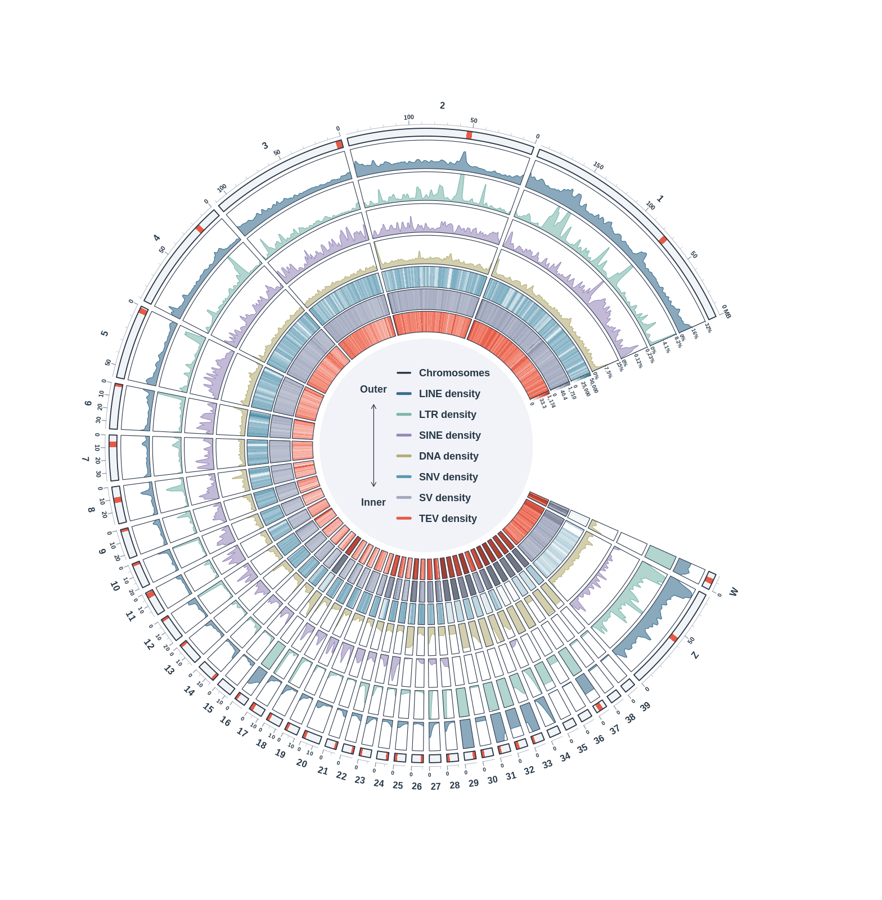

# Fig1 — Chicken GRCg7b TE and variant Circos (V15)

This is the **Circos component of Fig1**, using real GRCg7b data and the repository's `pangenome_spectrum` palette. It is not a replacement for the other Fig1 panels. The final R script and all small inputs needed to redraw are included.



## Run

From this folder:

```bash
# R + circlize are required. Install the project-local packages if necessary:
bash 06_scripts/install_circos_R_dependencies.sh
# Validate the actual inputs:
bash 06_scripts/run_circos_R_v15.sh --validate-only
# Export vector PDF/SVG, 600 dpi PNG and a small preview:
bash 06_scripts/run_circos_R_v15.sh
```

The shell entry point works from any current directory. R 4.1.2 and circlize 0.4.18 were used; the font is Liberation Sans. To preserve the committed exports on a rerun, add `--out-dir /absolute/path/to/new_output`. Plotting does not need the original BAM/FASTA/large VCFs. The package installer writes to `06_scripts/R_library`, not a system library.

## Final label change

V15 removes the opening-side `SNP/MB (linear)`, `SV/MB (log1p)` and `TIP/MB (log1p)` titles. Numeric ticks and the narrow gradients stay. The center labels are exactly **SNV density**, **SV density** and **TEV density**. These are display names: the input columns remain `SNP_adaptive_discovery_per_Mb`, `SV_per_Mb` and `TIP_extended_per_Mb`. No data or biological definitions changed.

## Data and interpretation

- All seven tracks use the same real **1,000,000 bp** window framework (1063 windows, actual-length terminal windows), GRCg7b coordinates and chromosome order 1–39/Z/W. The right opening is 48°, Chr1 starts upper-right and proceeds counterclockwise. Microchromosomes have display-angle enlargement; within-sector coordinates remain true bp.
- Four outer TE tracks are reference-assembly **within-class union coverage**, not polymorphism counts. Independent percent caps: LINE32%, LTR8.2%, SINE0.23%, DNA15%. LTR cap is raw q95, the others q99, rounded up to two significant digits; raw high windows are retained in the tables. Display smoothing and explicit annular clipping are unchanged from V14.
- **SNV density** is assembly-derived biallelic SNP discovery, not population allele frequency or joint sex-balanced genotyping. It includes the real Z/W recovery described in `docs/ZW_discovery_V11.md`. Default total: 20,552,376 independent sites. Linear cap50,000 per million reference bases.
- **SV density** is the existing Jasmine independent-site panel (123,901 sites), with the existing log1p display and midpoint window assignment. Panels are not pooled.
- **TEV density** retains the **extended** TIP/repeat-polymorphism panel (66,804 sites): includes INS/DEL and simple repeat/low complexity/satellite in addition to strict TE classes. It is not an insertion-only strict-TE count; the center rename does not narrow this dataset. Existing log1p display is retained.
- Density units, though their axis titles are intentionally omitted, remain **sites per 1,000,000 reference bases** (MB in the previous user-specified display). TE remains coverage (%). All scale/cap/clip information is in `track_scales.tsv`.
- Main plot has 34 transferred/approximate centromere candidates from35 supplied GGswu (GCA_024206055.2) intervals. One candidate maps principally to an unplaced sequence. Five candidates are only flank-bounded, not centromeric-core matches. GRCg7b15/27/34/35/36/38/39 have no supported marker. Red glyph width is schematic. These are not CENP-A validated coordinates; see `01_reference/v14/` and `docs/centromere_and_clipping_QC_V14.md`.

## Fixed colors

|Track|HEX|
|---|---|
|LINE|#386C8C|
|LTR|#7BB6AC|
|SINE|#9689B9|
|DNA|#B4AD74|
|SNV|#5899B2|
|SV|#A1A8BE|
|TEV|#E75A46|

Outline#253246, text#273746, white background; uniform ideogram#F1F4F6; full-height coral centromere glyphs. Root repository style is the visual source. The previously user-approved Circos-specific layout, independent coverage caps and density gradients remain; the GWAS-specific statistics and89-trait requirements do not apply to this density figure.

## Materials and provenance

`MATERIALS.tsv` records the original local paths, file sizes, publication decisions and SHA256 for included source materials. Small plotting tables, reference TE BEDs, aggregate annotation catalogs, sites-only Z/W VCF and centromere evidence are included. **No individual-level genotype matrix, phenotype matrix, raw GWAS matrix, BAM or FASTA is uploaded.** Larger VCFs and raw references/alignment sources remain at the recorded local paths; these paths are provenance, not public download URLs. The final images are included even when larger than the small-input cutoff.

The R input/output manifests preserve the original execution paths; the script resolves the included inputs relative to this folder after clone. `repository_files.sha256.tsv` checks the published files independently of those original machine paths. Optional historical preparation scripts have their original workspace dependencies and are not needed for redraw. The statistical preparation pipeline was not rerun for this label update.

Validation: exact seven-track input hashes, curves, scales, colors, centromere marks and heat colors match V14; actual PDF text has the requested center labels and no opening-side unit titles. Actual PNG is5880×6000 at600dpi. See `07_figures/R_v15/validation_report.json` and `portable_validation.json`.

## Combined panel (V16, optional)

`06_scripts/plot_combined_te_callouts_v16.R` composes the **unchanged V15 Circos** with the four
`assets/TE_architectures` callouts on its right, in a single R render, and writes
`07_figures/R_v16/`. It replaces the manual Illustrator paste-up: no panel is rasterised, and the
vector PDF stays editable.

```bash
bash 06_scripts/run_combined_v16.sh              # render + validate
bash 06_scripts/run_combined_v16.sh --dpi 300    # any V16 flag passes through
bash 06_scripts/run_combined_v16.sh --with-notes  # restore the grey in-figure notes
python3 06_scripts/check_combined_v16.py         # geometry + sha256 only, no re-render
```

The script re-implements no Circos logic: it sources `plot_chicken_circos_v15.R` and calls its
documented functions, so there is a single source of truth for the circle. The composite canvas is
15.8 × 10 in; V15's `figure_region` is converted to the new canvas so the circle keeps its exact
physical size and position. At 600 dpi the left panel is pixel-identical to `R_v15`
(0 / 30,096,000 pixels differ for x < 8.36 in); every differing pixel belongs to the added opening
arc, colour dots and four arrows.

The four arrows start inside the 48° opening at radius 1.005 (the outermost track is 0.9975) and
at 72/84/96/108°, i.e. inside the blank wedge, so they cannot cover a track, tick or chromosome
label. `check_combined_v16.py` re-verifies that from the recorded coordinates, together with sha256,
PNG pixel size and PDF MediaBox.

By default the four grey structure notes and the footer line are **not** drawn; the same caveats
(Envelope is optional/lineage-dependent, the SINE cartoon is a tRNA-type example, segments are not
to scale) live in `docs/FIGURE_LEGEND_combined.md` instead. `--with-notes` restores them.

V16 does not modify V15 files, inputs, statistics or `07_figures/R_v15`, and never writes into it.
Suggested caption: `docs/FIGURE_LEGEND_combined.md`. Output inventory: `07_figures/R_v16/README.md`.
