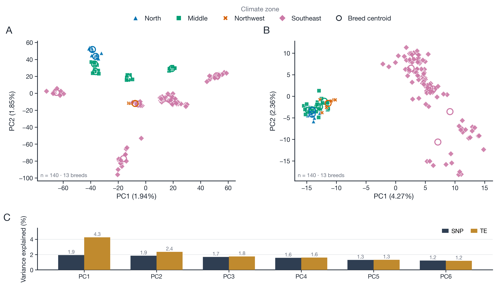

# fig1b_pca —— 群体结构 PCA（SNP × TE，同一队列）

同一批 140 只中国地方鸡、13 个品种，分别用 SNP 与 TE 两套分子标记做个体级 PCA，
按农业气候区着色 + 形状双编码，叠品种质心；下方 C 面板给 PC1–PC6 的解释方差对比。



成品：`fig1b_pca.png`（600 dpi，170 × 104 mm）+ `fig1b_pca.pdf`（矢量，文字可编辑）。

---

## 1. 与参考版式的差别（为什么另起一版）

参考图是 Yuan et al. 的 Fig 1B：单面板、只放一种标记、六区图例横排两行、无质心、无方差条。
本版按项目需要改了五处，避免与原文雷同：

| 元素 | 参考图 | 本图 |
|---|---|---|
| 面板数 | 1 个散点 | A = SNP、B = TE 两个散点，同一队列并排 |
| 图例 | 面板上方两行、带 "Climate zone" 标题框 | 单行通栏，标题斜体小字，另加"品种质心"图例项 |
| 数据点 | 仅个体 | 个体点 + 每品种一个空心圆质心（13 个） |
| 方差 | 只标 PC1/PC2 百分比 | 追加 C 面板，PC1–PC6 的 SNP vs TE 分组条形 |
| 配色 | 蓝/绿/红/紫（原文色板） | Okabe–Ito 色盲友好色板（#0072B2 / #009E73 / #D55E00 / #CC79A7） |

形状仍保留冗余编码：North ▲、Middle ■、Northwest ✕、Southeast ◆，灰度印刷也能区分。

---

## 2. 数据与口径

| 项 | 值 |
|---|---|
| 队列 | 249 只 / 20 组（12 主队列的 primary）→ 剔除惠阳胡须鸡 BC01–BC06 → **140 只 / 13 个品种** |
| 剔除 BC 的理由 | 两套标记里都自成一簇、远离同名"胡须鸡"批次（PC1 方向极端），判为批次离群 |
| SNP | 195,632 个 LD-pruned 位点（TE 回填用的 scaffold）→ MAF ≥ 0.05 后 **189,489** 个 |
| TE | 9,805 个常染色体位点 → MAF ≥ 0.05 后 **7,749** 个 |
| 缺失 | 位点均值填补；缺失率 > 20% 的位点剔除 |
| 算法 | 列中心化 → 个体间 Gram 矩阵 → 特征分解 → 得分 = U√λ；无标准化 |
| 结果 | SNP：PC1 **1.94%**、PC2 **1.85%**；TE：PC1 **4.27%**、PC2 **2.36%** |

**外类群为什么不进图**：249 队列里另有 3 个原鸡种（灰/绿/锡兰，38 只）和 3 个商业品系
（洛岛红 31、白来航 29、Cornish 5），共 103 只。它们把 PC1 拉到 9.10%（SNP）/12.49%（TE），
中国地方鸡全部挤成一团 —— 这正是参考图作者也遇到过的同款问题。要看全 249 的版本，
在服务器上跑 `COHORT=all` 再用同一脚本重画即可。

---

## 3. 复现

**第一步（服务器端，重算得分）**：`compute_pca_cohort.py` 在 `danding` 上跑，
输出到 `/tmp/f1b_pca/<COHORT>/`：

```bash
# 全部 249
COHORT=all      python3 compute_pca_cohort.py
# 146（去掉外类群）
COHORT=local    python3 compute_pca_cohort.py
# 140（再去掉 BC01–BC06，本图用的就是这个）
COHORT=local140 python3 compute_pca_cohort.py
```

**第二步（本地，出图）**：

```bash
python3 plot_fig1b_pca.py --data-dir data --out fig1b_pca
```

需要 `numpy` + `matplotlib`；字体优先 Helvetica Neue / Helvetica / Arial。
改画幅改脚本里的 `figsize=(170*MM, 104*MM)`，改配色改 `ZONES` 字典。

---

## 4. 输入表

`data/` 下四张小表（合计约 200 KB，可直接替换重画）：

| 文件 | 内容 |
|---|---|
| `pca_snp_scores.tsv` / `pca_te_scores.tsv` | 每样本 PC1–PC10（样本号已匿名化为 S001…） |
| `*_variance.tsv` | 每个 PC 的特征值、PVE、累积 PVE |
| `samples_meta.tsv` | 样本 → 品种 / 坐标组（不含经纬度） |
| `groups_zone.tsv` | 坐标组 → 农业气候区 |
| `summary.json` | 队列规模、位点数、PC1/PC2 解释度 |


---

## 5. 图注

**中文**
> 图 1B　中国地方鸡的群体结构。**(A)** 189,489 个 LD 剪枝 SNP 与 **(B)** 7,749 个 TE 位点的
> 个体级主成分分析（n = 140，13 个品种）。点按农业气候区着色并以形状区分（North ▲、Middle ■、
> Northwest ✕、Southeast ◆），空心圆为各品种质心。**(C)** PC1–PC6 的解释方差，深色为 SNP、
> 金色为 TE。PC 百分比为各标记集单独计算。数据来自 12 号流程的 primary 队列，
> 已剔除惠阳胡须鸡 BC01–BC06（两套标记中均为批次离群）。

**English**
> Figure 1B　Population structure of Chinese indigenous chickens. Individual-level PCA of
> **(A)** 189,489 LD-pruned SNPs and **(B)** 7,749 polymorphic TE loci (n = 140 individuals,
> 13 breeds). Points are coloured and shaped by agricultural climate zone (North ▲, Middle ■,
> Northwest ✕, Southeast ◆); open circles mark breed centroids. **(C)** Variance explained by
> PC1–PC6 for SNPs (dark) and TEs (gold). Percentages are computed within each marker set.
> The primary cohort (12) was used after removing Huiyang bearded chickens BC01–BC06,
> which were batch outliers in both marker sets.

---

## 6. 注意事项

1. **PC1 只有 1.94%（SNP）** 是这类个体级 PCA 的常态（参考图 863 那篇也只有 1.83%）；
   想要更高的百分比得画**品种均值 PCA**（20 组版 PC1 = 32.17%），但每个点只代表一个品种。
2. **TE 版含 19.93% 的 Beagle 回填值**，图注里建议补一句，否则不满足项目自己的方法学边界。
3. `data/` 已匿名化（S001…，无经纬度），可以直接入库；原始得分表留在
   `ChickenTE/figures/_repo_preview/server/local140/`。
4. 气候区判定依赖 `climate_zone_provinces.tsv` 的省→区映射，改分区口径后重跑
   `groups_zone.tsv` 即可，绘图脚本不用动。
