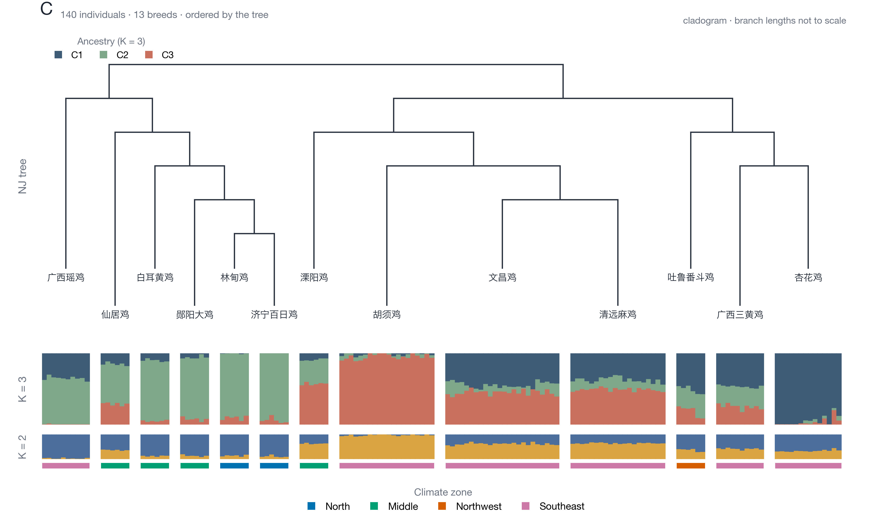

# fig1c_tree_admixture —— 系统发育树 + 群体祖源（树与 admixture 连成一体）

13 个品种的邻接法（NJ）树在上，140 个个体的祖源比例条在下；每根树枝的末端直接落到该品种
对应的色块中心，所以两张图读起来是一个对象，而不是上下拼贴。



成品：`fig1c_tree_admixture.png`（600 dpi，176 × 104 mm）+ `fig1c_tree_admixture.pdf`（矢量）。

---

## 1. 仓库里原来有没有这张图

**没有。** 逐个模块查过：`china_sampling_map`（省/点地图）、`corr_ci_scatter`（方法一致性散点）、
`niche_overlap_null`（零分布）、`gea_driver_radar`（雷达）、`gea_marginal_scatter`（GEA 散点）、
`pca_climate_zone`（PCA）、`te_ibe_adaptive_neutral`（IBD/IBE）、`te_factor_polar`（极坐标）、
`world_distribution_map`（采样地图）、`variable_contribution`（贡献排序）、`fig1b_pca`（PCA 双标记）、
`fig1_chicken_GRCg7b_circos`（圈图）——没有任何树图或 admixture 图，文件名里也搜不到
`tree / admixture / snmf / structure`。

服务器上的历史 `Figure1_sampling_and_structure.png`（01 流程）是"地图 + PCA + 圈图 + 热图"
四联图，也没有树和 admixture。所以这张是现算的。

---

## 2. 数据与算法

| 步骤 | 做法 |
|---|---|
| 队列 | 12 号流程 primary，剔外类群 + 剔惠阳胡须鸡 BC01–BC06 → **140 只 / 13 个品种** |
| 位点 | 195,632 个 LD 剪枝 SNP 中随机抽 40,000 个（MAF 5–95%，缺失率 ≤10%，seed 20261110） |
| 距离 | 品种间 Rogers 距离 `sqrt(mean((p1−p2)²))`，用品种等位基因频率算，13×13 |
| 树 | Saitou–Nei 邻接法（NJ）；画成**分支图（cladogram）**，分支长度不按比例 |
| 祖源 | LEA `snmf`，K = 2–5，每档 2 次重复，5 折交叉熵选 K |
| 交叉熵 | K=2 **0.7400**、K=3 **0.7389**（最小）、K=4 0.7423、K=5 0.7462 → 取 K=3 为主图，K=2 作对照 |

三种祖源成分的实际含义（看品种均值）：

- **C1（深蓝）**：杏花鸡 0.95、吐鲁番斗鸡 0.51、广西三黄鸡 0.47 —— 华南 + 西北的独立支系
- **C2（灰绿）**：林甸鸡 0.91、济宁百日鸡 0.94、白耳黄鸡 0.85、郧阳大鸡 0.87 —— 北方支系
- **C3（砖红）**：胡须鸡 0.95、清远麻鸡 0.49、文昌鸡 0.45 —— 华南沿海支系

K=2 时基本是"北方 vs 南方"二分。

---

## 3. 版式

- **一体式**：树从 y=0 向上长，祖源条从 y=0 向下挂，每个叶节点一条细线连到自己的色块中心；
- **品种名标在枝端**（13 个名字交错成两行，避免相邻枝条重叠），不再放在图顶当表头；
- **叶节点按树排序**，品种之间留固定间隙，块宽 = 该品种个体数（6–24 只）；
- **两道祖源条**：K=3（主）在上、K=2（对照）在下，共用同一条 x 轴；
- **气候区色带**压在最下面，和 `fig1b_pca` 用同一套 Okabe–Ito 配色，两张图可以并排看；
- 中文字体用 Hiragino Sans GB（PDF 里嵌了子集，Illustrator 打开可改字）。

---

## 4. 复现

**服务器端**（`danding`）：

```bash
python3 prepare_tree_admixture.py     # 抽 SNP 子集 + 品种频率，写 /tmp/f1c
Rscript run_snmf.R                    # LEA snmf K=2..5，写 Q_k*.tsv
```

**本地**：

```bash
python3 plot_fig1c_tree_admixture.py --data-dir data --out fig1c_tree_admixture
```

依赖 `numpy` + `matplotlib`；树和 NJ 都在脚本里实现，不需要 scipy/ape。

---

## 5. 图注

**中文**
> 图 1C　13 个中国地方鸡品种的系统发育关系与群体祖源。上：基于 40,000 个 LD 剪枝 SNP 的
> Rogers 距离构建的邻接法（NJ）树（分支图，长度不按比例），叶节点按树排序。下：LEA snmf
> 估计的个体祖源比例，K = 3（主）与 K = 2（对照），每个色块对应一个品种，块宽为个体数
> （n = 140）。底部色带为农业气候区。K 值由 5 折交叉熵选定（K=3 最低，0.7389）。

**English**
> Figure 1C　Phylogeny and ancestry of 13 Chinese indigenous chicken breeds. Top: neighbour-joining
> tree on Rogers' distance from 40,000 LD-pruned SNPs (cladogram, branch lengths not to scale),
> leaves ordered by the tree. Bottom: individual ancestry proportions from LEA snmf at K = 3 (main)
> and K = 2 (control); each block is one breed, block width proportional to sample size (n = 140).
> The colour strip gives the agricultural climate zone. K was chosen by 5-fold cross-entropy
> (minimum at K = 3, 0.7389).

---

## 6. 注意

1. **NJ 树是"平"的**——13 个品种两两距离都在 0.22–0.42 之间，深层节点极短，所以画成分支图；
   若强行按分支长度画，会得到一张星形树（每个品种等距），反而看不出结构。
2. **snmf 的 K=2 与 K=3 交叉熵只差 0.001**，等于"二分成因"和"三分成因"数据都支持；
   主图给 K=3 是取最小值，但正文里不要把它当成唯一正确答案。
3. **祖源条是模型拟合值**，不是真实血统；品种内出现条纹（个体差异）是正常的。
4. `data/` 已匿名化（S001…），可直接入库。
