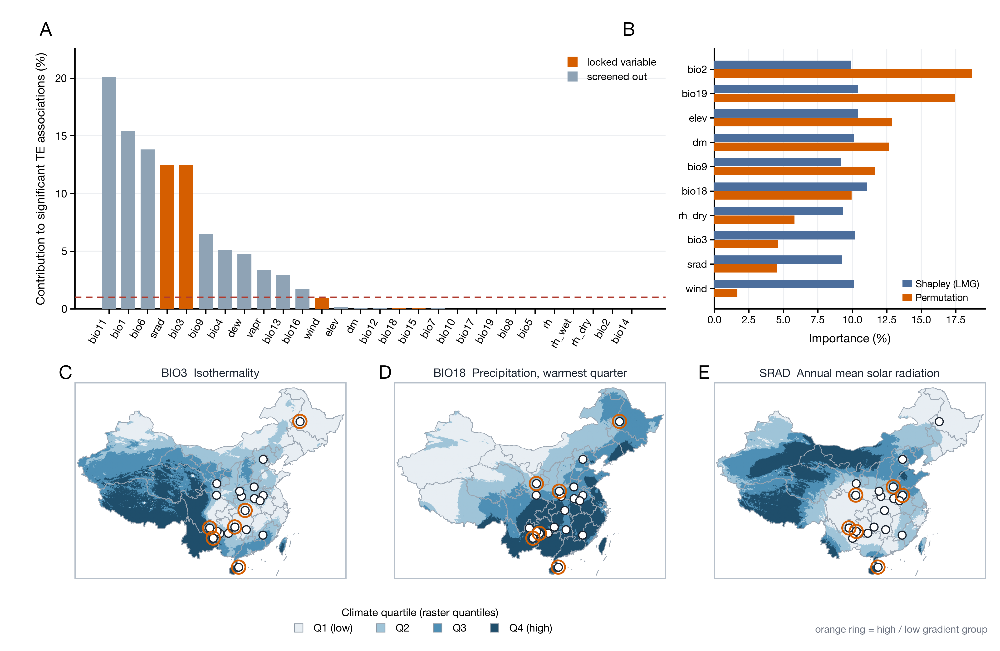

# fig2_environment —— 环境变量（贡献 + 方差分解 + 空间分布）



A 面板：28 个候选变量对显著 TE 关联的边际贡献（橙色 = 项目锁定的 5 个变量，红色虚线 = 1% 筛选线）。
B 面板：10 个核心变量的方差分解（Shapley/LMG vs 置换重要性）。
C–E：三个气候轴的空间分布（bio3 等温性、bio18 最热季降水、SRA 年均辐射），白点 = 20 个品种原产地代表点，橙圈 = 每个变量取值最高/最低的 3 个组（极端梯度分析用的分组）。

成品：`fig2_environment.png`（600 dpi，178 × 116 mm）+ `fig2_environment.pdf`。

---

## 1. 为什么这样画

参照 Yuan et al.（Zool Res）Fig 2 的四段结构：变量贡献条形 → 重要性折线 → 空间分布图。

**没有照抄 MaxEnt 适生区**：原文 C–E 是 ENM 预测的适生概率，我们每个品种只有 1–3 个原产地代表点，
拟合不出可靠的生态位模型。所以 C–E 画的是**气候变量本身的空间分布**，图注里明确写"不是适生区预测"。

四档配色按**全国栅格的分位数**（30 / 55 / 78 百分位）切分，不是按采样点切分——否则点全部落在最高档，
整张图只剩一种颜色。

---

## 2. 数据

| 文件 | 内容 |
|---|---|
| `data/variable_stats.tsv` | 28 个变量的边际贡献；10 个核心变量的 Shapley / 置换重要性 |
| `data/breed_climate.tsv` | 20 个品种的原产地经纬度 + 117 个气候字段 |
| `data/bio3.npy` / `bio18.npy` / `srad.npy` | WorldClim 2.1 5 arc-min 裁到中国（73–135.5°E，17.5–54.5°N，444 × 750） |
| `data/extent.json` | 栅格范围与分辨率 |

- 气候栅格取自服务器 `/data/shine_work/01_workflow/01_worldclim/data/tif/`；
- `srad` 由 12 个月度层求年均，单位换算 kJ m⁻² day⁻¹ → W m⁻²（×0.0115741）；
- 中国边界来自仓库 `world_distribution_map/data/china_provinces.geojson`，用复合路径把栅格裁成中国形状。

---

## 3. 复现

```bash
# 服务器端：裁栅格（一次性）
python3 prep_worldclim.py          # 输出到 /tmp/f2env/（裁片已随仓库提供，可跳过）

# 本地：出图
python3 plot_fig2_env.py --data-dir data --out fig2_environment
```

依赖 numpy + matplotlib，不需要 GDAL/rasterio（`prep_worldclim.py` 用 PIL 读 GeoTIFF）。

---

## 4. 图注

**中文**
> 图 2　驱动 TE–气候关联的环境变量。**(A)** 28 个候选变量对显著 TE 关联的边际贡献；橙色为项目锁定的
> 5 个变量，红色虚线为 1% 筛选线。**(B)** 10 个核心变量的方差分解：Shapley（LMG）贡献与置换重要性。
> **(C–E)** (C) bio3 等温性、(D) bio18 最热季降水、(E) 年均太阳辐射在中国的空间分布，按全国栅格分位数
> 分为四档；白色圆点为 20 个品种的原产地代表点，橙色圆环标出各变量取值最高与最低的 3 个组。
> 本图为气候变量的空间分布，不是适生区预测。

**English**
> Figure 2　Environmental variables behind the TE–climate screen. **(A)** Marginal contribution of the 28
> screened variables to significant TE associations; orange marks the five locked variables, the red dashed
> line is the 1 % cut-off. **(B)** Variance decomposition of the ten core variables (Shapley/LMG vs
> permutation importance). **(C–E)** Spatial distribution of (C) bio3 isothermality, (D) bio18 precipitation
> of the warmest quarter and (E) annual mean solar radiation over China, binned by national raster quantiles;
> white dots are the 20 breed origins, orange rings mark the three highest and three lowest groups per
> variable. These are climate surfaces, not habitat-suitability predictions.

---

## 5. 注意

1. **不是适生区**。没有 ENM，不要在正文里写 "suitable area"。
2. **分档是相对的**：四档由全国栅格分位数决定，换分辨率或范围颜色会变，图注要写明分位点。
3. **采样点是中国境内的 20 个品种**，不含外类群。
4. A/B 的数字来自 28 变量 × 15,620 位点的旧一轮筛查；若改成 249 队列的 5 变量重算，A/B 需要同步更新。
