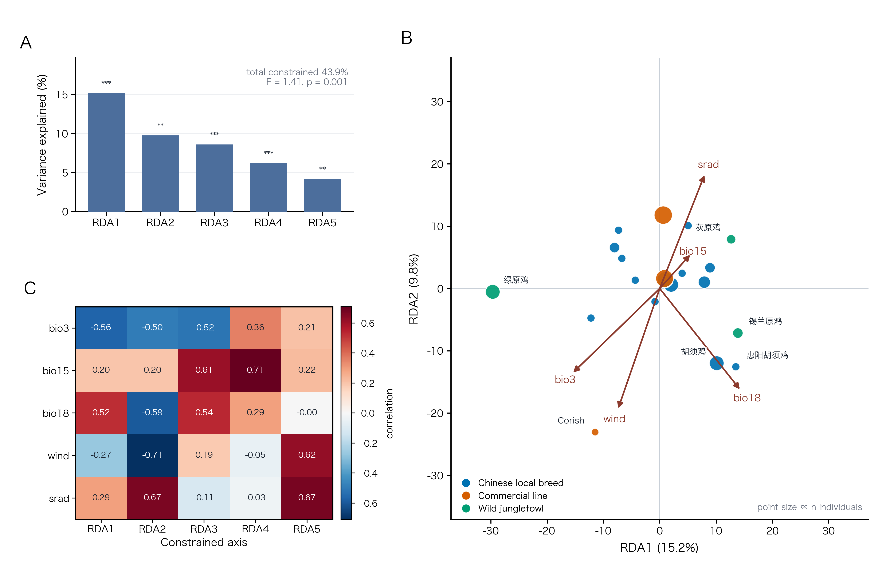

# fig3_rda —— 冗余分析（RDA）：TE 组成 vs 气候



**A** 五个约束轴各自解释的方差（%），星号为置换检验显著性
**B** RDA 三序图：20 个品种组（点大小 ∝ 个体数）+ 5 条气候箭头
**C** 变量 × 轴 相关矩阵（这张表在 `rda_summary.txt` 里原样就有）

成品：`fig3_rda.png`（600 dpi，178 × 116 mm）+ `fig3_rda.pdf`。

---

## 1. 这张图在回答什么

前面的图交代了样本、结构、环境；这张开始讲结果：**TE 组成能不能被气候解释，能解释多少，落在哪几个轴上。**

关键数字（来自 `rda_summary.txt`）：

| 项 | 值 |
|---|---|
| 队列 | 品种级，n = 20 组 |
| 位点 | 1,578 个 TE |
| 气候变量 | 5 个（bio3 / bio15 / bio18 / wind / srad） |
| 条件变量 | 经纬度 + 全基因组 SNP-PC1–3 |
| 总约束解释 | 43.85% |
| 整体模型 | 伪 F = 1.406，置换 p = 0.001 |
| 各轴 | RDA1 15.2%、RDA2 9.8%、RDA3 8.6%、RDA4 6.2%、RDA5 4.2%，全部 p ≤ 0.003 |

C 面板能直接读出的故事：**bio3 主导 RDA1（−0.56）**，**wind 主导 RDA2（−0.71）**，**bio15 在 RDA4（0.71）**、
**srad 在 RDA5（0.67）**——也就是五个轴各对应一条不同的气候梯度，不是同一个梯度的重复。

---

## 2. 数据

| 文件 | 来源 |
|---|---|
| `data/rda_sample_scores.csv` | 服务器 `03_workflowTE/04_association/results/primary_pc3/` |
| `data/rda_summary.txt` | 同上（轴解释度、置换 p、变量×轴相关） |

品种个体数（用于点大小）来自 `samples_with_environment.tsv` 的 primary 队列（249 只 / 20 组），
已硬编码在脚本的 `COUNT` 字典里。

---

## 3. 复现

```bash
python3 plot_fig3_rda.py --data-dir data --out fig3_rda
```

依赖 numpy + matplotlib。脚本自己解析 `rda_summary.txt`（正则抽轴与相关表），不需要 vegan。

---

## 4. 图注

**中文**
> 图 3　TE 组成与气候梯度的冗余分析（RDA）。**(A)** 五个约束轴解释的方差百分比，星号为 999 次置换检验的
> 显著性（\*p<0.05，\*\*p<0.01，\*\*\*p≤0.001）；右上角为整体模型（伪 F = 1.41，p = 0.001，总约束解释 43.9%）。
> **(B)** RDA1–RDA2 三序图：蓝点为 20 个中国地方品种组、橙点为商业品系、绿点为原鸡，点面积与个体数成正比；
> 箭头为 5 个气候变量与两个约束轴的相关方向。**(C)** 5 个气候变量与 5 个约束轴的相关矩阵。
> 条件变量为经纬度与全基因组 SNP 前三个主成分。

**English**
> Figure 3　Redundancy analysis (RDA) of TE composition against climate. **(A)** Variance explained by each of
> the five constrained axes, with permutation significance (\*p<0.05, \*\*p<0.01, \*\*\*p≤0.001); the inset gives
> the global model (pseudo-F = 1.41, p = 0.001, 43.9 % constrained). **(B)** RDA1–RDA2 triplot for the 20 breed
> groups (blue, Chinese local; orange, commercial; green, junglefowl), point area proportional to sample size;
> arrows give the correlation of the five climate variables with the two axes. **(C)** Correlation matrix of
> the climate variables against the five constrained axes. Longitude, latitude and the first three genome-wide
> SNP PCs were used as conditioning variables.

---

## 5. 注意

1. **箭头画的是相关系数，不是 vegan 的 biplot 分数**。方向和相对大小可直接读，但箭头的绝对值没有单位；
   图注里写的是 "correlation"。
2. **品种级 n = 20**：一个点代表一个品种组，不是一只鸡。点大小用个体数补信息量。
3. **A 面板的百分比是占总方差**，不是占约束方差；两者差 2.3 倍（43.9% 约束），图注要写清。
4. **还没做**：D（校正层级下的信号收缩）和 E（Spearman/LFMM/RDA 三方法韦恩），数据还要从 03 的
   敏感性结果里汇总。
