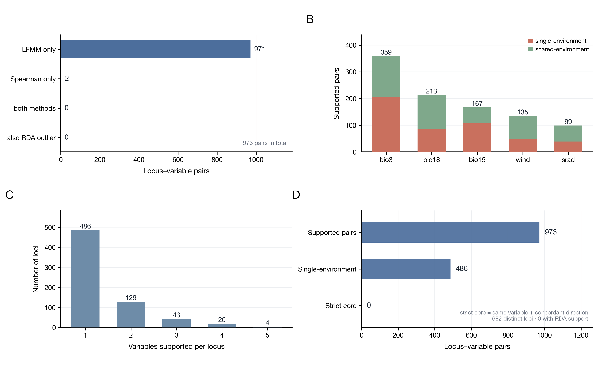

# fig4_evidence —— 跨方法证据与收缩



**A** 973 个 locus–variable 对由谁支持：LFMM-only 971、Spearman-only 2、两法都有 **0**、同时是 RDA 离群的 **0**
**B** 每个气候变量被多少对支持，按"单变量/共享变量"分层
**C** 每个位点被几个气候变量支持（682 个位点）
**D** 证据阶梯：973 对 → 486 单环境 → **0 严格核心**

成品：`fig4_evidence.png`（600 dpi，178 × 108 mm）+ `fig4_evidence.pdf`。

---

## 1. 这张图在说什么

Fig 3 说明"43.9% 的 TE 变异能被气候解释"；这张接着说"具体到 locus–variable 对，两种方法几乎没有共同支持"。
两句连起来，才能把"稳健核心为 0"讲成一个可解释的结论，而不是自我否定。

| 数字 | 含义 |
|---|---|
| 973 | 支持的 locus–variable 对 |
| 682 | 涉及的不同 TE 位点 |
| 486 | 只与单一环境变量关联的对 |
| 487 | 与多个变量共享的对 |
| 0 | 同变量 + 同方向（两法互证） |
| 0 | 也是 RDA 离群位点的对 |

A 面板是这张图的关键：**971 / 2 / 0**。LFMM 给出几乎全部证据，Spearman 只贡献 2 对，两法交集为零——
不是"没有信号"，而是**两种方法给出的证据形态几乎不重叠**。

---

## 2. 数据

| 文件 | 来源 |
|---|---|
| `data/te_env_pair_evidence.csv` | 服务器 `03_workflowTE/06_integration/results/primary/`，973 行 × 38 列 |

关键列：`method_support`、`environment_specificity`、`same_variable_core`、`spearman_q`、`lfmm_q`、
`direction_concordance`、`rda_locus_support`、`te_class`、`te_family`。

---

## 3. 复现

```bash
python3 plot_fig4_evidence.py --data-dir data --out fig4_evidence
```

依赖 pandas + matplotlib；四个面板全部来自同一张表，不需要重跑模型。

---

## 4. 图注

**中文**
> 图 4　TE–气候关联的跨方法证据。(A) 973 个 locus–variable 对的方法归属：LFMM 单独支持 971 对、Spearman
> 单独支持 2 对、两法共同支持 0 对、同时为 RDA 载荷离群位点的 0 对。(B) 各气候变量的支持对数，按单环境
> 特异性（红）与共享（绿）分层。(C) 每个位点被支持的气候变量数（n = 682 个位点）。(D) 证据阶梯：973 对
> 支持 → 486 对单环境特异 → 0 对满足"同变量 + 同方向"的严格核心。

**English**
> Figure 4　Cross-method evidence for TE–climate associations. (A) Method attribution of the 973 locus–variable
> pairs: 971 supported by LFMM only, 2 by Spearman only, 0 by both, and 0 whose locus is also an RDA loading
> outlier. (B) Supported pairs per climate variable, split into single-environment (red) and shared (green).
> (C) Number of climate variables supporting each locus (682 loci). (D) Evidence ladder: 973 supported pairs →
> 486 single-environment pairs → 0 pairs meeting the strict same-variable, same-direction core.

---

## 5. 注意

1. **"0" 是结果，不是画错**。964 对里 LFMM 占 971，两法交集天然为 0；图注要先把方法构成讲清楚。
2. **A 面板的 RDA 项是位点级标记**：`rda_locus_support` 只表示"该位点是否 RDA 离群"，不绑定变量。
3. **C 面板的单位是位点**（682），与 A/B/D 的"对"（973）不能相加。
4. **韦恩图被弃用**：三圈交集为 0 时韦恩会画成三个互不相交的圆，容易被误读；改用 A 的归属条形 + D 的阶梯。
5. 这一版只用了 `06_integration` 的 primary 口径；`coordinate_supported` 口径另有一套数，需要时再出一版对照。
