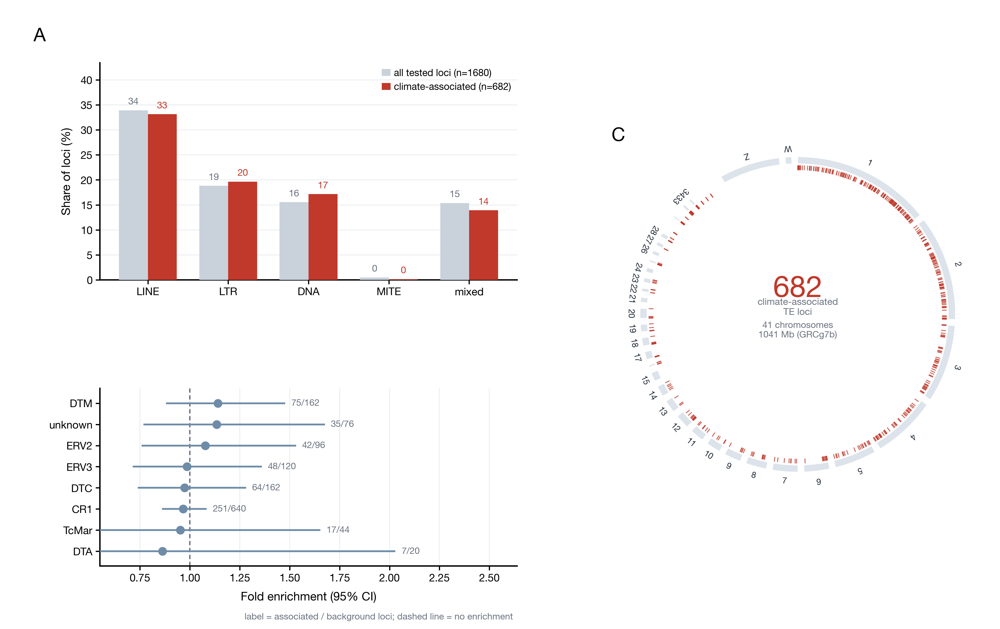

# fig5_te —— 这些 TE 是什么：家族构成与染色体分布



**A** 全部被测位点（n=1,680）与气候关联位点（n=682）的 TE 大类构成对比
**B** 超家族层面的富集倍数（含 95% 置信区间）
**C** 682 个关联位点在 41 条染色体上的位置（GRCg7b）

成品：`fig5_te.png`（600 dpi，178 × 112 mm）+ `fig5_te.pdf`。

---

## 1. 结论先说：没有富集

这是这张图最重要的一句话，也是和预期相反的地方：

> **气候关联位点的 TE 构成，和全部被测位点的构成几乎一样。**

| 大类 | 全部被测 | 气候关联 |
|---|---|---|
| LINE | 34% | 33% |
| LTR | 19% | 20% |
| DNA | 16% | 17% |
| 混合注释 | 15% | 14% |

B 面板的超家族富集更直接：DTM 1.14、unknown 1.13、ERV2 1.06、ERV3 0.98、CR1 0.96、TcMar 0.95、DTA 0.86——
**所有 95% 置信区间都跨过 1.0**，没有一个超家族显著富集。

这和项目概述里“显著 TE 中 LINE/CR1 与 LTR/ERV 占比突出”不矛盾，但需要改口径：
LINE/CR1 占 33% 是因为**背景里本来就有 34%**，不是被气候“挑出来”的。写正文时应该说
“关联位点的家族构成与背景一致，未见家族层面的富集”，而不是“LINE/CR1 富集”。

---

## 2. C 面板在说什么

682 个位点分布在 41 条染色体上（1–39、Z、W，共 1.04 Gb）。红刻度是每个位点的位置，环的弧长按染色体实际长度比例。

可以看出：
- **1–5 号染色体最密**（它们也最长，且基因密度高）；
- **微染色体（29–38 号）几乎没有点**——这些染色体本身只有 0.1–0.7 Mb，被测位点本来就少；
- 没有明显的“热点区段”，分布大致随染色体长度摊开。

**这就是“没有富集”的第二个证据**：如果信号集中在特定区段，环上会出现成簇的红带，实际没有。

---

## 3. 数据

| 文件 | 内容 | 来源 |
|---|---|---|
| `data/te_catalog.csv` | 1,680 个被测位点的注释（family / class / superfamily） | `03_workflowTE/02_te_genotype/results/primary/` |
| `data/main.chrom.sizes` | GRCg7b 41 条染色体长度 | 仓库 `fig1_chicken_GRCg7b_circos/01_reference/` |
| `../Fig4/data/te_env_pair_evidence.csv` | 682 个关联位点（与 Fig4 共用） | `03_workflowTE/06_integration/` |

---

## 4. 复现

```bash
python3 plot_fig5_te.py --data-dir data --out fig5_te
```

依赖 pandas + matplotlib；环形图是手写极坐标，不依赖 circlize/GDAL。

---

## 5. 图注

**中文**
> 图 5　气候关联 TE 位点的家族构成与染色体分布。**(A)** 全部被测位点（n = 1,680）与气候关联位点（n = 682）
> 的 TE 大类构成；多位点按首个注释大类归类，其余记为 "mixed"。**(B)** 超家族层面的富集倍数（观测/期望）
> 及 95% 置信区间，虚线为无富集（1.0），所有区间均跨过 1。**(C)** 682 个关联位点在 GRCg7b 41 条染色体上的
> 位置，弧长按染色体长度比例。

**English**
> Figure 5　TE family composition and chromosomal distribution of the climate-associated loci. **(A)** Class
> composition of all tested loci (n = 1,680) versus the climate-associated loci (n = 682); loci with multiple
> annotations are pooled as "mixed". **(B)** Superfamily-level fold enrichment (observed/expected) with 95%
> confidence intervals; the dashed line marks no enrichment and every interval crosses it. **(C)** Positions of
> the 682 associated loci across the 41 GRCg7b chromosomes, arc length proportional to chromosome size.

---

## 6. 注意

1. **注释是多对多的**：一个位点可能同时标到 LINE、LTR、DNA，A 面板按“首个大类”归类，mixed 是其余情况，
   所以四类加起来是 100%，但分子分母都做了简化。
2. **富集检验是近似的**：用的是比值 + 对数正态 CI，不是 Fisher 精确检验；样本量小时 CI 很宽（见 TcMar、DTA）。
3. **单位是位点不是证据对**：682 个位点来自 973 个 locus–variable 对，和 Fig4 的口径要区分。
4. **染色体环只标了较大的染色体**，小于 1 Mb 的微染色体没有标号，避免文字重叠。
