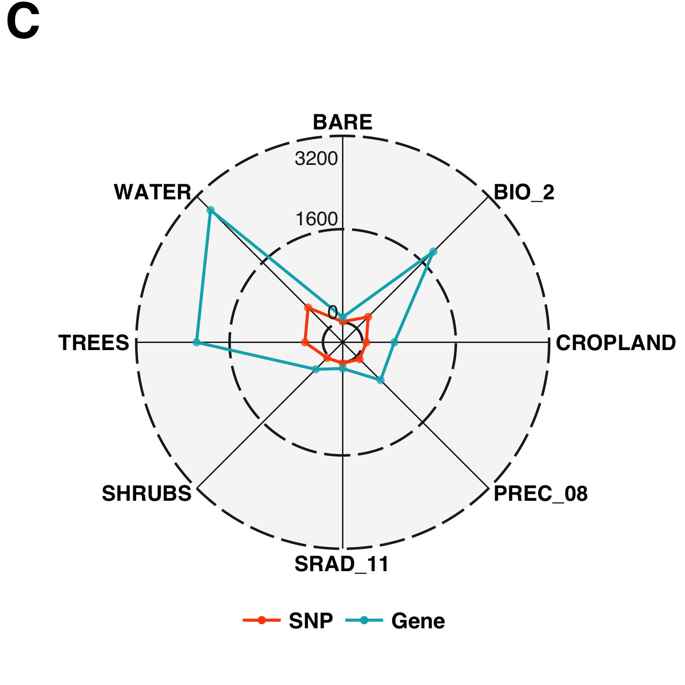
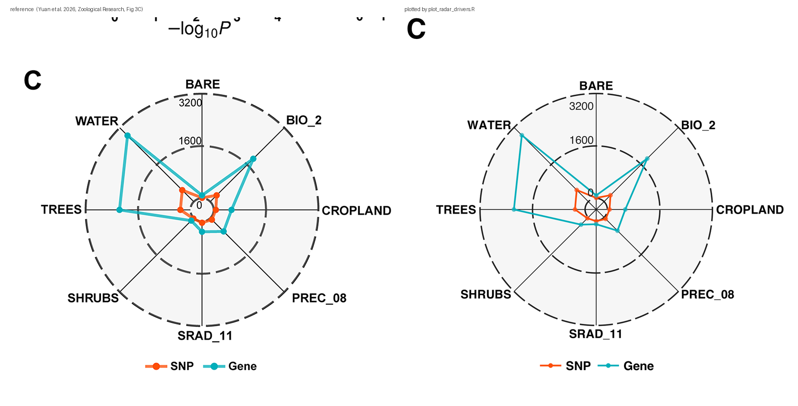
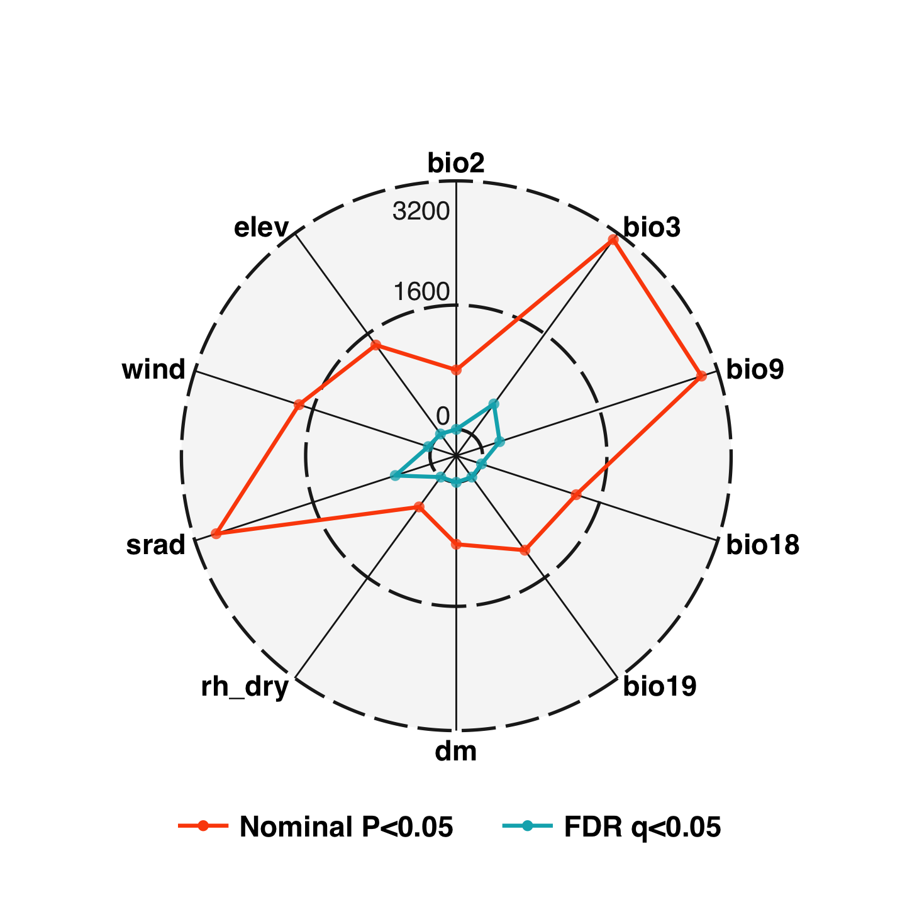

# GEA driver radar

A radar (spider) chart of **environmental drivers × number of associated
variants**, reproducing the panel style of Yuan et al. (2026, *Zoological
Research* 47: 1793–1812) Figure 3C — one spoke per climate variable, one
polygon per evidence layer.



Same figure, side by side with the original at identical scale (both panels are
drawn at 12.4 px mm⁻¹; the only intended difference is the SHRUBS / SRAD_11
transposition documented further down):



## What the reference panel actually plots

The caption reads "the number of environment-associated SNPs and the number of
annotated genes for each environmental variable". Both series are counts, on a
shared radial scale:

| spoke (clockwise from top) | BARE | BIO_2 | CROPLAND | PREC_08 | SRAD_11 | SHRUBS | TREES | WATER |
|---|---|---|---|---|---|---|---|---|
| candidate SNPs (RDA ∩ LFMM) | 13 | 276 | 66 | 69 | 19 | 39 | 307 | 500 |
| annotated genes | 90 | 1860 | 546 | 578 | 110 | 315 | 2167 | 2865 |

(values from the paper's Results text, p. 1801)

## Style spec (reverse-engineered from the published panel)

The panel was measured pixel by pixel at its print size (2008 px = 459.2 pt =
162 mm, i.e. 314 dpi), which pins every geometric constant:

| element | value |
|---|---|
| radial scale | linear, **0 → 3200**; rings drawn at **0 / 1600 / 3200** |
| centre hole | value 0 sits at **9.6 % of the radius**, not at the centre |
| ring style | dashed, #1F1F1F, 0.30 mm, dash 2.3 mm / gap 0.68 mm |
| spokes | solid #1A1A1A, 0.16 mm, no arrowheads, full radius |
| panel | filled circle #F6F6F6, no border, white outside |
| series colours | `#FC4E07` (first layer) and `#00AFBB` (second layer) |
| outlines | 0.36 mm, round joins |
| markers | diameter 0.98 mm, same colour at **alpha 0.75** (lighter than the line) |
| type | sans bold — axis labels 5.4 pt, radial ticks 5.0 pt, legend 5.5 pt |
| legend | one row under the circle, short line + marker, black bold text |

`plot_radar_drivers.R` draws exactly this. Everything is placed in millimetre
coordinates, so a 6 pt label really is 6 pt in the PDF and the spokes stay
straight (a `coord_polar()` + `geom_path()` radar bends each edge into an arc —
that is why this script does not use polar coordinates).

## A transposition in the published panel

The paper's two spokes for SHRUBS and SRAD_11 are **swapped** relative to its own
text. Fitting the measured vertex radii (in mm) against the tabulated counts
gives `r = 23.1 + 0.0639 × value` (rings then land on 1600 and 3200, R² ≈ 1), and
back-solving the two disputed vertices:

| spoke | text value | radius → implied value |
|---|---|---|
| SHRUBS (lower left) | 315 | 30.0 px → **108** |
| SRAD_11 (bottom) | 110 | 43.3 px → **316** |

i.e. the plotted values are correct but the two *labels* are transposed, most
likely because the label vector was written `…, PREC_08, SRAD_11, SHRUBS, …`
while the data frame ran `…, PREC_08, SHRUBS, SRAD_11, …`. `example_paper_fig3c.tsv`
therefore uses the axis order of the published panel with the values of the
published text, so the reproduction differs from the paper on exactly those two
spokes — deliberately.

## Input

Tab-separated, header required:

| column | meaning |
|---|---|
| `variable` | spoke label; **file order = clockwise from the top** |
| `series` | polygon; file order also sets the legend order |
| `value` | plotted count (0 is allowed; values above `--ymax` are clipped) |

A variable may appear in any row order, but its first appearance fixes the
spoke. An optional `variable / label` table (`--labels`) renames the spokes for
display without touching the data.

## Run

```bash
Rscript plot_radar_drivers.R \
  --input example_paper_fig3c.tsv --out radar_paper_fig3c \
  --ymax 3200 --breaks 0,1600,3200 --tag C

Rscript plot_radar_drivers.R \
  --input chickente_te_counts.tsv --out radar_chickente_te \
  --ymax 3200 --breaks 0,1600,3200
```

Writes `<out>.png` (600 dpi) and `<out>.pdf` (vector, text still editable).
Requires R ≥ 4.1 and `ggplot2` only — no `fmsb`, `plotrix` or `patchwork`.

### Options

| flag | default | |
|---|---|---|
| `--input` | — | counts table (required) |
| `--out` | `radar` | output stem |
| `--ymax` | data max | radial maximum, i.e. the outer ring |
| `--breaks` | `pretty()` | comma-separated ring values, e.g. `0,1600,3200` |
| `--hole-frac` | `0.096` | where value 0 sits, as a fraction of the radius |
| `--labels` | none | `variable` → display label table |
| `--tag` | none | panel letter, e.g. `C` |
| `--radius` | `18.5` | radar radius in mm |
| `--axis-size` / `--ring-size` / `--legend-size` | `5.4` / `5.0` / `5.5` | pt |
| `--colours` | `#FC4E07,#00AFBB` | one colour per series |
| `--point-size` / `--point-alpha` | `0.98` / `0.75` | marker diameter (mm) / opacity |
| `--lw-series` / `--lw-ring` / `--lw-spoke` | `0.36` / `0.30` / `0.16` | mm |
| `--dash-on` / `--dash-off` | `2.3` / `0.68` | mm, rings only |
| `--frame` | `1.66` | canvas half-width / radius — raise it if labels get clipped |
| `--dpi` | `600` | PNG resolution |

## The ChickenTE instance



Data: `~/Desktop/ChickenTE/severdata/te_env_out/te_assoc_diagnostics.csv`
(16 361 TE deletion/insertion loci called from 29 populations, 10 retained
climate variables after VIF pruning; Spearman correlation of TE presence against
each variable, per variable 15 620 tested loci).

| spoke | bio2 | bio3 | bio9 | bio18 | bio19 | dm | rh_dry | srad | wind | elev |
|---|---|---|---|---|---|---|---|---|---|---|
| nominal P<0.05 | 765 | 3101 | 2981 | 1284 | 1164 | 800 | 475 | 2911 | 1789 | 1422 |
| FDR q<0.05 | 0 | 484 | 248 | 2 | 0 | 3 | 0 | 486 | 39 | 6 |

Read it as: three dry-season/radiation gradients (bio3 = isothermality,
bio9 = mean temperature of the driest quarter, srad = solar radiation) carry real
signal; everything else collapses once FDR is applied.

**Why the second layer is not "genes".** The reference figure's second polygon
counts genes annotated to the candidate SNPs. For this dataset there is no
TE→gene annotation yet, and the two-method candidate set
(Spearman ∩ RDA outlier = 10 loci: bio3 × 6, srad × 3, bio9 × 1) is far too
sparse to fill a radar. The two layers plotted are therefore the same test at
two stringencies, which is what the data can currently support.

To switch to the reference structure, add a third column of gene counts and pass
`--input` a table whose `series` values are `TE` and `Gene`; the script needs no
other change. The gene layer follows from a GFF (chicken GRCg6a) plus a
`bedtools closest` / `intersect` call on the candidate loci.

## Deliberate overrides of the house style

This module reproduces one specific published panel, so it knowingly departs
from the `figure-style` defaults:

* **colours are hex, not palette slots** — `#FC4E07` / `#00AFBB` are the source
  panel's own colours; the ChickenTE instance has to sit next to that
  reproduction and read as the same figure;
* **everything is bold, and a panel letter is drawn although the output is a
  single panel** — both copied from the source layout;
* **font sizes are absolute pt measured off the source** (5.4 / 5.0 / 5.5), not
  `type_scale` multiples;
* the script is self-contained (`ggplot2` only) and does not load
  `figure-style/style/ggplot2_theme.R`, because the geometry is drawn in
  millimetres and the source spec, not a shared theme, drives every constant.

Swap `--colours` if a figure has to drop back into the palette system.

## Notes

* The PNG written by R's macOS `quartz` device carries a *Generic RGB* ICC
  profile, so raw pixel values are ~2/255 away from the hex codes while the
  displayed colour is correct. The **PDF holds the exact colours**
  (`#FC4E07`, `#00AFBB`, `#F6F6F6`, `#1F1F1F`) — use it for submission.
* Reproducing the published panel: `radar_paper_fig3c` matches the original to
  within ~1 px on the grid, the spokes, all 16 vertices and the legend; see the
  transposition note above for the one intended difference.
