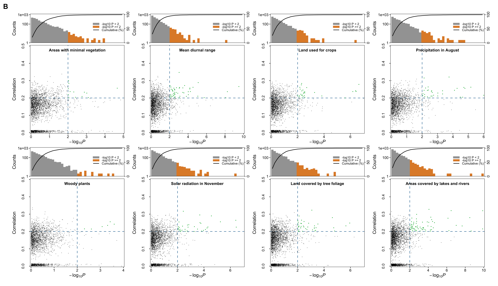

# GEA screen: RDA correlation vs LFMM −log10(P)

One panel per environmental variable, laid out like Figure 3B of Yuan et al.
(2026, *Zoological Research*): the scatter shows each SNP's RDA correlation
(y) against its LFMM −log10(P) (x), and a marginal strip on top shows the
distribution of −log10(P) together with its cumulative percentage.



## What one panel says

* **x** — LFMM P-value for that environmental variable. The default cut-off
  `--thr-p 0.01` draws the rule at −log10(P) = 2.
* **y** — RDA correlation coefficient (the SNP's loading on the significant RDA
  axis). The default cut-off `--thr-r 0.2` draws the horizontal rule.
* **green points** — SNP passes *both* cut-offs, i.e. a candidate SNP supported
  by the two independent methods. Everything else stays black.
* **top strip** — histogram of −log10(P) across every SNP fed in, counts on a
  log10 axis (left) and cumulative percentage (right). The bars are split at the
  P cut-off (grey below, orange above); the thin orange tail is normally what you
  see, because almost no SNP reaches the threshold.

## Input

Tab-separated with a header line:

| column | meaning |
|---|---|
| `trait` | environmental variable; one panel per distinct value |
| `r` | RDA correlation coefficient |
| `p` | LFMM P-value (or FDR q-value — then set `--thr-p` to the q cut-off) |
| `snp` | optional SNP id, not used for plotting |

`example_labels.tsv` (columns `trait`, `label`) optionally maps the short codes
in `trait` to the longer titles printed inside each panel.

## Run

```bash
Rscript plot_gea_panels.R \
  --input example_gea_stats.tsv \
  --labels example_labels.tsv \
  --out gea_marginal_scatter
```

Writes `gea_marginal_scatter.png` (600 dpi) and `gea_marginal_scatter.pdf`
(vector). Requires R ≥ 4.1 with `ggplot2`, `patchwork` and `scales`:

```r
install.packages(c("ggplot2", "patchwork", "scales"))
```

### Options

| flag | default | |
|---|---|---|
| `--input` | — | stats table (required) |
| `--labels` | none | `trait` → display label table |
| `--out` | `gea_panels` | output stem |
| `--thr-r` | `0.2` | \|r\| cut-off |
| `--thr-p` | `0.01` | P/q cut-off, 0.01 → x = 2 |
| `--abs-r` | off | take \|r\| before plotting (use if `r` is signed) |
| `--ncol` | `4` | panels per row |
| `--width` / `--height` | `12` / `6.9` | inches |
| `--dpi` | `600` | PNG resolution |
| `--tag` | `B` | panel letter, `""` to omit |
| `--xmax` | per trait | force one x limit for every panel |
| `--bins` | `40` | histogram bins per panel |

## Two things that are easy to get wrong

1. **Feed every tested SNP, not just the outliers.** The strip is the marginal
   distribution of the points below; if the table only contains RDA outliers the
   histogram, the cumulative curve and the count axis all describe a different
   population from the one the reader assumes.
2. **x limits are free per panel by default.** That is what the published figure
   does, and it lets each panel use its full range, but it means "far right" is
   not comparable across panels. Pass `--xmax 6` to put them all on one scale.

The count axis is logarithmic, so a bar of height 1 sits on the baseline: bins
with one or two SNPs are invisible by design. Bars are drawn as `log10(count)`
on a linear axis rather than with `scale_y_log10()`, because `sec_axis()`
transforms are applied in the transformed space and the percentage axis would be
silently wrong — this is the one implementation detail worth keeping if the
script is rewritten.

## Data provenance

`example_gea_stats.tsv` is **synthetic**, generated by `make_example_data.R`
(19,717 rows, 8 variables, seed 20260301). −log10(P) is drawn from an exponential
with a variable rate per trait, RDA correlation is weakly tied to it, and ~22% of
the rows are pushed to r ≈ 0 to reproduce the dense floor of real GEA plots.
Nothing here comes from a real dataset; regenerate with:

```bash
Rscript make_example_data.R
```
