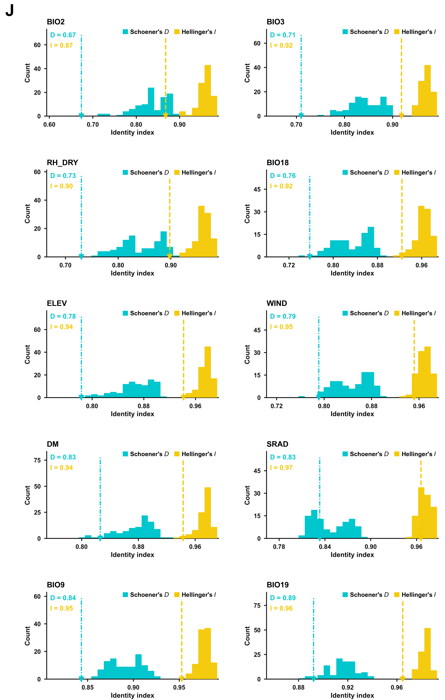

# Niche overlap null distributions（Figure 2J 版式）

一类很常见的"观测值 vs 零分布"面板图：**每个环境变量一个面板**，画两次置换/
伪重复得到的重叠指数零分布（直方图），再把真实观测值用虚线 + 轴底倒三角钉在
同一根轴上。



本模块把这张图的**版式**抽出来做成通用脚本：输入是一张长表（变量 / 指标 /
重复编号 / 数值）加一张观测值表（变量 / D / I），输出 2 列多行的成品图。
底层统计量是什么都行 —— ENM 的适生区重叠、TE 插入频谱重叠、任意两组分布的
D/I 都能直接喂进来。

---

## 1. 原图在讲什么

Yuan et al. (2026, *Zoological Research*) Figure 2J 的做法：

1. 对每个环境变量（BARE、BIO_2、CROPLAND …），把 44 个地方鸡群体按该变量的取值
   排序，取最高 3 个群体当 **H 组**、最低 3 个当 **L 组**；
2. 两组分别用 MaxEnt 建生态位模型，ENMTools 算两个适生区之间的
   **Schoener's D** 与 **Hellinger's I**（0 = 完全不重叠，1 = 完全重叠）；
3. 随机重分组 100 次（pseudo-replicates），每次同样建模 + 算 D/I → 得到
   *零分布*：如果 H/L 分组本身没有意义，重叠指数就该落在这一坨里；
4. 观测值画成竖虚线 + 轴底倒三角，左上角写数字。

所有变量的观测值都远在零分布左侧 → "极端环境组之间的生态位显著分化"。

图的解剖：

| 元素 | 含义 |
|---|---|
| 青色柱 | 100 次置换的 Schoener's D 零分布 |
| 黄色柱 | 100 次置换的 Hellinger's I 零分布 |
| 青色点划线 + 倒三角 | 实际观测 D |
| 黄色虚线 + 倒三角 | 实际观测 I |
| 左上角 `D = …` / `I = …` | 观测值数值（与线同色） |
| 右上角图例 | 两个方块 = 两种指标 |

---

## 2. 本模块的三件事

1. `plot_niche_overlap_null.py` —— **纯版式**。读两张 TSV，出 2 列多行、每面板
   双直方图 + 双观测线的图；面板顺序、列数、柱数、面板字母都可调。
2. `compute_te_overlap.py` —— **本次 demo 的数据源**：用 TE 插入频谱算 D/I
   （我们手上没有 MaxEnt 栅格，但 D/I 的公式是同一套）。
3. `data/` 里是算好的小表（只有汇总，没有个体记录），可以直接拿去画。
4. `example/` 是**合成数值**的示例，不依赖本项目任何文件，克隆下来就能验证版式（§4.1）。

> 为什么 demo 不用 ENM：ENM 需要 MaxEnt 输出 0–1 适生概率栅格，本机/服务器
> 目前没有这一步。TE 版把"适生概率分布"换成"TE 插入频率谱"，其余（分组规则、
> 置换次数、D/I 公式、版式）完全照抄。想换成真 ENM，见 §7。

---

## 3. 输入格式

`--null`（长表，每行一次置换的一个指标）：

| variable | metric | replicate | value |
|---|---|---|---|
| bio2 | D | 1 | 0.8237 |
| bio2 | I | 1 | 0.9601 |
| … | … | … | … |

`--observed`（每个面板一行，多出来的列会被忽略）：

| variable | n_loci | D_obs | I_obs |
|---|---|---|---|
| bio2 | 250 | 0.674 | 0.868 |

`metric` 只认 `D` / `I` 两个值；`variable` 就是面板标题（画的时候自动转大写）。

---

## 4. 跑

```bash
# ① 从 TE 数据算观测值 + 零分布（需要本地 severdata 那份导出）
python3 compute_te_overlap.py \
    --pav  ~/Desktop/ChickenTE/severdata/te_env_out/te_pav_breed_matrix.csv \
    --env  ~/Desktop/ChickenTE/severdata/te_env_out/env_matrix_raw.csv \
    --assoc ~/Desktop/ChickenTE/severdata/te_env_out/te_locus_assoc.csv \
    --breed-meta data/breed_metadata.tsv --outdir data

# ② 出图
python3 plot_niche_overlap_null.py \
    --null data/null_distributions.tsv \
    --observed data/observed_overlap.tsv \
    --out niche_overlap_null
```

只重画、不重算时只跑 ②。常用开关：

| 开关 | 作用 |
|---|---|
| `--ncol 2` | 每行几个面板 |
| `--bins 22` | 每个面板的柱数（也可用 `--binsize 0.01` 固定柱宽） |
| `--order obs` | 面板顺序：`obs` = 按观测 D 从低到高，`file` = 输入顺序，或 `bio2,bio3,…` |
| `--tag J` | 整图左上角的面板字母，`--tag ""` 去掉 |
| `--xlabel` / `--ylabel` | 轴标题 |
| `--legend-d` / `--legend-i` | 两个指标在图例里的名字（可写 mathtext） |
| `--width` / `--row-height` | 画幅（英寸） |

依赖：Python 3.9+、`numpy`、`matplotlib`、`pandas`。

### 4.1 不想碰本项目数据，先跑示例

`example/` 里有一份**合成数值**，不依赖 ChickenTE 的任何文件，克隆下来就能验证版式：

```bash
python3 example/make_example.py           # -> example/example_null.tsv / example_observed.tsv
python3 plot_niche_overlap_null.py \
    --null example/example_null.tsv \
    --observed example/example_observed.tsv \
    --out example/example_figure --tag ""
```

### 4.2 复用到别的指标

这张图只认"两个分布 + 两个观测值"，指标叫什么、怎么算都不影响画图。复用清单：

1. 只要求两张 TSV 的**列名**（`variable/metric/replicate/value` 与 `variable/D_obs/I_obs`），
   其余随便；
2. 换成别的相似度指标（Jaccard、Sørensen、AUC 差…）时，把 `--xlabel`、`--legend-d`、
   `--legend-i` 一起改掉，公式本身不用进这个脚本；
3. 配色 / 字体是脚本顶部的常量（`C_D`、`C_I`、`FONT`），改一行即可；
4. 面板数、列数、顺序、面板字母全部是参数；
5. `compute_te_overlap.py` 只是本项目的算例，换数据时自己写一段算 D/I 的代码
   （公式见 §5），或者直接喂 ENMTools 的输出（§6）。

---

## 5. 本次 demo 的统计口径

数据（都来自服务器那一轮 TE–环境关联分析，本地导出在
`~/Desktop/ChickenTE/severdata/te_env_out/`）：

| 文件 | 内容 |
|---|---|
| `te_pav_breed_matrix.csv` | 29 个群体 × 16,361 个 TE 位点的插入频率（0–1） |
| `env_matrix_raw.csv` | 29 个群体 × 28 个环境变量的原始值 |
| `te_locus_assoc.csv` | 每个 TE 位点 × 每个环境变量的 Spearman ρ / p / q |

口径：

* **品种池**：13 个中国地方鸡（`data/breed_metadata.tsv` 里 `category=local`），
  去掉原鸡与商业品系，避免物种/驯化背景污染分组；
* **位点 QC**：缺失率 ≤20%（16,361 → 16,354），剩余缺失用该位点均值补齐；
* **位点选择**：每个环境变量取 |ρ| 前 250 个位点（≈1.5%）；
* **H / L 组**：该变量取值最高 / 最低的 3 个品种（与原图一致）；
* **频率向量**：H、L 组在这些位点上的平均插入频率，各自归一化后代入
  `D = 1 − ½Σ|p−q|`、`I = 1 − ½Σ(√p−√q)²`；
* **零分布**：100 次随机抽互斥的 3+3 个品种，重复同样的计算（seed 20261104）。

结果（`data/overlap_summary.tsv`）：

| variable | D_obs | D_null | p | I_obs | I_null | p |
|---|---|---|---|---|---|---|
| bio2 | 0.674 | 0.834 | <0.01 | 0.868 | 0.959 | <0.01 |
| bio3 | 0.710 | 0.843 | <0.01 | 0.918 | 0.969 | <0.01 |
| rh_dry | 0.730 | 0.843 | <0.01 | 0.898 | 0.961 | <0.01 |
| bio18 | 0.758 | 0.834 | 0.01 | 0.924 | 0.963 | 0.02 |
| elev | 0.783 | 0.867 | <0.01 | 0.942 | 0.976 | <0.01 |
| wind | 0.791 | 0.848 | 0.01 | 0.952 | 0.968 | 0.08 |
| dm | 0.826 | 0.876 | 0.05 | 0.943 | 0.973 | 0.03 |
| bio9 | 0.843 | 0.891 | <0.01 | 0.953 | 0.977 | <0.01 |
| srad | 0.833 | 0.846 | 0.43 | 0.966 | 0.970 | 0.32 |
| bio19 | 0.892 | 0.916 | 0.04 | 0.965 | 0.983 | <0.01 |

**局限（写正文前必须处理）**

1. ρ 是在 29 个群体（含原鸡、商业鸡）上算的，H/L 只在 13 个地方鸡里选；
2. 位点按 |ρ| 选、分组又按同一个变量，存在选择性偏差（自证倾向）；
3. 所以这张图现在的定位是**版式演示**：证明脚本能出这张图、数值是真实算的，
   但"TE 谱分化"这个结论要正名，得按 §7 换口径或换 ENM。

---

## 6. 换成 ENM（原版）的接法

ENMTools 侧（R）：

```r
library(ENMTools)
# 对每个变量：H/L 两组各取 3 个群体的 occurrences + 背景
# 1) 观测值
obs <- niche.overlap(sp1 = enm_H, sp2 = enm_L, correct = TRUE)
# 2) 100 次伪重复：随机把 occurrences 重分成两组，重建模型再算
null <- replicate(100, {
  d <- sample_occurrences(...); niche.overlap(build(d$A), build(d$B), correct = TRUE)
})
```

把结果摊成长表（`variable`, `metric`, `replicate`, `value`）和观测表
（`variable`, `D_obs`, `I_obs`）后，`plot_niche_overlap_null.py` 一行都不用改。

---

## 7. 样式

* 颜色取自原图像素：D `#00C6CE`、I `#F4C901`；其余黑色 `#111111`；
* 字体 Arial（无则退 Helvetica / DejaVu Sans），标题、轴标签、刻度全部 bold；
* 只留左/下 spine；柱状图无描边；观测线 D 用点划线、I 用虚线；
* 600 dpi PNG + 矢量 PDF（文字可编辑，`pdf.fonttype=42`）；
* 左侧留约 36% 空槽放 `D = … / I = …`（原图左侧大片留白也是这个用法）。

---

## 8. 文件

| 文件 | 说明 |
|---|---|
| `compute_te_overlap.py` | 从 PAV / env / assoc 三张表算观测 D/I + 置换零分布 |
| `plot_niche_overlap_null.py` | 版式脚本，读两张 TSV 出图 |
| `data/breed_metadata.tsv` | 29 个群体的品种池标记（local / commercial / jungle_fowl） |
| `data/observed_overlap.tsv` | 每个变量的观测 D/I（含 H/L 组名单、位点数） |
| `data/null_distributions.tsv` | 100×10×2 条零分布记录（画图输入） |
| `data/overlap_summary.tsv` | 观测 vs 零分布汇总 + 置换 p 值 |
| `niche_overlap_null.png` / `.pdf` | 成品图（5×2 面板） |
| `example/make_example.py` | 合成示例数据生成器（与真实数据无关，供复用试验） |
| `CAPTIONS.md` | 中英双语图注 |
