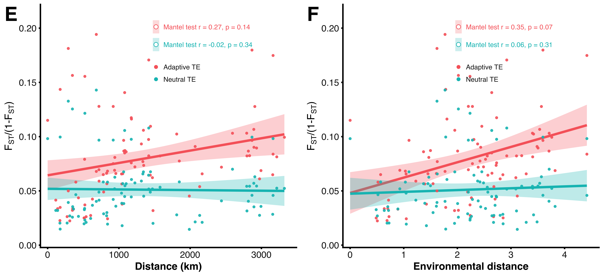

# te_ibe_adaptive_neutral — IBD / IBE：自适应 TE vs 中性 TE

复刻 Yuan et al. 2026 *Zoological Research*（sample.pdf）**Figure 3E / 3F** 的版式与统计口径，
把原文的「自适应 SNP / 中性 SNP」换成「自适应 TE / 中性 TE」，用本项目的 TE 存在剂量数据重算。



| 面板 | 横轴 | 纵轴 | 两条线 |
|---|---|---|---|
| **E**（左） | 群体间地理距离（km，Haversine） | FST/(1−FST) | 红=自适应 TE，青=中性 TE，各一条 lm 回归 + 95% CI |
| **F**（右） | 群体间环境距离（5 个标准化环境变量的欧氏距离） | 同上 | 同上 |

图例里的 `Mantel test r/p` = 该位点集合的 FST/(1−FST) 距离矩阵与横轴距离矩阵的 Mantel 相关，
9999 次群体标签置换（单侧 greater），与 `vegan::mantel` 默认口径一致。

---

## 1. 数据来源

原始数据来自服务器 `shine@8.134.79.130:6002`：

```
/data/shine_work/14_TE_403_downstream_20261030/results/input/primary20/
    te_dosage.csv      249 个体 × 9765 个有变异 TE 的存在剂量 0/1/2（已用 SNP 单倍型 + Beagle 5.5 插补）
    samples.tsv        个体 → 组（breed）、reviewed_longitude/latitude
    environment.csv    个体 → 5 个标准化环境变量（bio3/bio15/bio18/wind/srad，组内共享）
/data/shine_work/14_TE_403_downstream_20261030/results/integration/
    primary20_all_evidence.tsv.gz   位点 × 变量的 LFMM2 q 值、PC3 偏 Spearman q、strict/exploratory 标记
```

本目录 `input/` 里是**中国地方鸡 14 组子集**的群体级聚合表（不含个体记录，压缩后共约 285 KB），
可脱离服务器完整重跑：

| 文件 | 内容 |
|---|---|
| `cn14_group_freq.csv.gz` | 14 组 × 9765 TE 的组内等位基因频率 p（= 平均剂量/2） |
| `cn14_group_het.csv.gz` | 14 组 × 9765 TE 的**观测杂合度** h（剂量为 1 的个体比例） |
| `cn14_groups.tsv` | 组名、样本量、经纬度、5 个标准化环境变量 |
| `adaptive_loci_lfmm_q05.txt` | 366 个自适应 TE 位点（LFMM2 K10 genomic-control q<0.05，5 个变量取最小） |

群体级表已经足以算出 Weir–Cockerham θ（只需 p 与 h），所以 146 个个体的剂量矩阵不必入库。

> 插补说明：3,163,874 个 call 为原始实测，787,541 个为 SNP 单倍型插补（占 19.9%）。
> 组内共享环境值意味着 **20/22 组才是独立样本单位**，个体层面的名义显著性偏乐观。

## 2. 方法

1. **群体单元**：24 个 breed 组中取有环境信息的 20 组（`primary20` 队列）。本图默认只用
   **中国地方鸡 14 组**（去掉 3 个原鸡种 灰原鸡/绿原鸡/锡兰原鸡 与 3 个外源商业品种
   Corish/洛岛红/白来航），理由见第 5 节。成对比较数 = K(K−1)/2 = 91。
2. **遗传分化**：逐位点 Weir & Cockerham (1984) θ，两个群体、样本量不等时用完整公式
   （h 取**观测杂合度** = 该组该位点剂量为 1 的个体比例）；成对汇总用
   **ratio-of-averages** Σa/Σ(a+b+c)（与 VCFtools 加权 FST 同一口径，Bhatia et al. 2013）。
   FST/(1−FST) = Rousset (1997) 的线性化。
3. **地理距离**：群体代表坐标之间的 Haversine 大圆距离（km，R=6371.0088）。
4. **环境距离**：已标准化的 5 个环境变量的欧氏距离（原文即用「所有标准化环境变量的欧氏距离」）。
5. **Mantel**：Pearson 相关 + 9999 次置换（置换群体标签，即同时置换矩阵行列），p=(#{r*≥r}+1)/(9999+1)。
6. **回归线**：`geom_smooth(method="lm")`，95% CI 带。

### 为什么用观测杂合度

W&C 公式里的 h 必须是观测杂合度。用 2p(1−p) 近似（只拿到等位基因频率时的常见省事写法）会在
低分化时明显高估：Balding–Nichols 模拟（θ=0.05，n=6/6，9765 个位点）给

| 实现 | 估计值（真值 0.05） |
|---|---:|
| h = 2p(1−p)，ratio-of-averages | 0.0585（+17%） |
| **h = 观测杂合度，ratio-of-averages** | **0.0494（−1%）** |
| h = 观测杂合度，逐位点取平均 | 0.0322（−36%） |

θ=0.02 时前者 0.0306（+53%），后者 0.0215。TE 数据本来就是 0/1/2 基因型，直接算观测杂合度没有额外成本。

## 3. 结果（本目录图）

队列：14 个中国地方鸡品种、146 个体、9765 个 TE、366 自适应 / 9399 中性。

| 位点集合 | 地理距离 | 环境距离 |
|---|---|---|
| 自适应 TE（366） | r = 0.27, p = 0.14 | **r = 0.35, p = 0.067** |
| 中性 TE（9399） | r = −0.02, p = 0.34 | r = 0.06, p = 0.31 |

定性上与原文献一致：**环境关联的 TE 有随环境距离分化的趋势，中性 TE 两者都没有信号**；
但只有 14 个群体（91 对），Mantel 功效有限，p 在 0.05 边缘。

## 4. 怎么改

```bash
# 本目录重跑（读 input/ 的群体级聚合表，结果与服务器个体级流程一致）
Rscript te_ibe_mantel.R \
  --freq input/cn14_group_freq.csv.gz --het input/cn14_group_het.csv.gz \
  --groups-file input/cn14_groups.tsv \
  --adaptive-file input/adaptive_loci_lfmm_q05.txt --outdir .

# 只改配色/版式，不重算：读已有成对表直接重画
Rscript te_ibe_mantel.R --from-pairs . --outdir repaint

# 用服务器原始个体级数据（在项目工作目录里）
Rscript te_ibe_mantel.R --outdir out_cn14 --cohort cn14      # 14 个中国地方鸡
Rscript te_ibe_mantel.R --outdir out_domestic --cohort domestic   # 再去掉原鸡（17 组）
Rscript te_ibe_mantel.R --outdir out_all --cohort all        # 20 组，含原鸡/商业品种
```

关键参数：

| 参数 | 含义 |
|---|---|
| `--cohort` | `all` / `domestic` / `cn14`（默认） |
| `--rule` | `lfmm`（默认，LFMM2 q）/ `pc3`（PC3 偏 Spearman q）/ `strict` / `exploratory` |
| `--qcut` | q 阈值，默认 0.05 |
| `--adaptive-file` | 直接给位点清单（一行一个 locus），跳过 `--rule` |
| `--perm` / `--seed` | 置换次数（默认 9999）/ 随机种子 |
| `--from-pairs` | 只重画图模式 |
| `--freq` / `--het` / `--groups-file` | 群体级聚合表入口（绕开个体剂量矩阵） |

换成 SNP 数据只需提供同格式的「个体 × 位点剂量」表 + 组标签 + 坐标 + 环境，其余完全不变。

## 5. 注意与局限

- **队列口径会改变结论**。同样 366 个自适应位点：

  | 队列 | K | 自适应 vs 地理 | 自适应 vs 环境 | 中性 vs 地理 | 中性 vs 环境 |
  |---|---:|---|---|---|---|
  | 14 中国地方鸡 | 14 | 0.27 (p=0.14) | 0.35 (p=0.067) | −0.02 (p=0.34) | 0.06 (p=0.31) |
  | 17 去原鸡 | 17 | 0.62 (p=0.008) | 0.38 (p=0.065) | 0.55 (p=0.017) | 0.21 (p=0.14) |
  | 20 全队列 | 20 | 0.20 (p=0.15) | 0.65 (p=0.0001) | 0.36 (p=0.065) | 0.63 (p=0.0005) |

  20 组时 FST/(1−FST) 最高到 1.7，几乎全部来自「原鸡 vs 家鸡」的种级分化——这会把
  「环境距离大」直接翻译成「物种不同」，构成 IBE 的伪信号。**做中国地方鸡的适应性讨论时不要用 20 组版本。**
- **“自适应 TE”是探索性的**。14_TE 报告里严格跨方法核心为 **0 个位点**（LFMM 与组水平 PC3/PC3geo
  同向 q<0.05），宽松探索集合 3 个；本图用的 366 个是 **LFMM 单独 q<0.05**，而 LFMM 的
  genomic-control λ 在 1.6–3.5，q 值偏乐观。放进正文前需要明确标注这一点，或用 `--rule strict`
  看极端情况（0 个位点，脚本会警告）。
- **插补**：约 20% 的 call 来自 SNP 单倍型插补，不等同实测；TE 频率的组内误差未计入 Mantel 的置换。
- **Mantel 的功效**：只有 14 个群体 → 91 对，且群体间并非独立（共享历史），
  r 的置信区间很宽；报告 r/p 的同时应说明 K。
- **未做 partial Mantel**。原文正文提到 IBE 用 partial Mantel（控制地理距离），
  图内图例只写 Mantel。若要更严格，可在本脚本基础上对 E 面板加控制矩阵
  （先对两距离矩阵按地理距离做回归，取残差再相关，置换方式不变）。
- 环境距离用了模型里的 5 个变量（bio3/bio15/bio18/wind/srad），不是全部 87 个变量；
  换变量会改变 F 面板的绝对位置，但不影响 E 面板。

## 6. 文件清单

| 文件 | 说明 |
|---|---|
| `te_ibe_mantel.R` | 全流程脚本（数据 → FST → 距离 → Mantel → 图），含 `--from-pairs` 重画模式 |
| `input/` | cn14 群体级聚合表 + 自适应位点清单，可离线重跑 |
| `te_ibe_pairs.tsv` | 每个群体对 × 两个位点集合：FST、FST/(1−FST)、地理距离、环境距离 |
| `te_ibe_mantel.tsv` | Mantel 结果（cohort / class / dist / r / p / n_pairs / n_loci / 规则） |
| `te_ibe_groups.tsv` | 群体级汇总：样本量、经纬度、5 个环境变量 |
| `te_ibe_adaptive_neutral.png` | 600 dpi 位图（11.1 × 5.06 in） |
| `te_ibe_adaptive_neutral.pdf` | 矢量版（Helvetica） |
