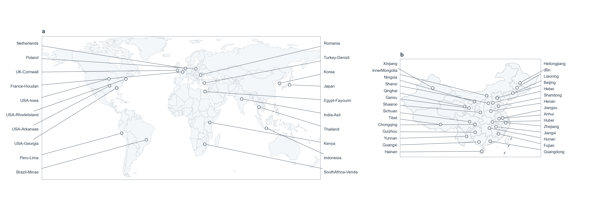

# 全球 + 中国双面板分布图（地图外标注 + 引导线）

一种很常见的"样本来源地图"版式：左边一张世界地图、右边一张中国放大图，**地名
不压在地图上**，而是在地图左右两侧的空白里竖排，用 0.3 pt 的细直线牵到对应的点。
家养动物种质资源 / 泛基因组论文的 Figure 1 基本都是这个套路。



---

## 1. 这张图在回答什么问题

- **数据是什么**：每个样本（品种、群体、个体）一个经纬度，按"全球"和"中国"两套
  面板分别画点。
- **版式在解决什么**：中国 30 个省的品种点挤在一起，直接标字必然互相压住；把字挪到
  图外、按纬度顺序排成两列，再用引导线指回去，就能在 260 mm 宽里放下 50 个名字。
- **不能怎么用**：这张图只说"样本从哪来"，不说"品种分布范围"。一个省只放一个点
  不代表品种只分布在那一个点；引导线更不代表迁徙路线。

---

## 2. 本模块的几件事

| 文件 | 作用 |
|---|---|
| `plot_world_distribution_map.py` | 纯 matplotlib + GeoJSON，无 geopandas / GDAL；读一张 TSV 出双面板图 |
| `samples.tsv` | **示例数据**（世界 20 条 + 中国 29 条），坐标是编的，只用来演示版式 |
| `data/world_countries_110m.geojson` | Natural Earth 1:110m 国界（public domain） |
| `data/china_provinces.geojson` | 省级行政区（阿里 DataV，供示例使用） |
| `data/china_maritime.geojson` | 南海断续线（绘制用，非审图底图） |

开关：

```bash
python3 plot_world_distribution_map.py                 # paper 底图，带外侧标注
python3 plot_world_distribution_map.py --basemap terrain
python3 plot_world_distribution_map.py --no-labels     # 只要点，不要字
python3 plot_world_distribution_map.py --no-panel-letters
python3 plot_world_distribution_map.py --samples my.tsv --stem fig1_map
python3 plot_world_distribution_map.py --relief NE1_50M_SR_W.png   # 可选：真实地形底图
```

输出：`fig_world_distribution.png`（600 dpi，260 × 94 mm）+ 同名矢量 PDF。

---

## 3. 数据契约

`samples.tsv`，制表符分隔，必须有表头：

| 列 | 必填 | 说明 |
|---|---|---|
| `sample` | ✔ | 图外侧印的名字；控制在 18 个字符内，否则会顶到隔壁面板 |
| `panel` | ✔ | `world` 或 `china`，决定画在哪个面板 |
| `lon` | ✔ | 十进制度，WGS-84 |
| `lat` | ✔ | 十进制度 |
| `note` | | 随意，脚本不读 |
| `side` | 选填 | `left` / `right`，手动指定标注放哪一侧 |

不给 `side` 时，脚本按该面板所有点的**中位数经度**分左右——这样两列标签数量接近，
不会出现"30 个名字全挤在右边"。点特别密、或者某条引导线横穿半张图的时候，就手动
填 `side`，或者把 `sample` 换个更短的写法。

---

## 4. 版式细节（改之前先看一眼）

- 画幅 260 × 94 mm（`FIG_W/FIG_H`），世界面板 0.465 宽、中国面板 0.235 宽；
- 字号：标签 5.0 / 4.9 pt，面板字母 7 pt；引导线 0.30 pt；点位直径约 1 mm
  （白底 + `#273746` 描边 0.45 pt）；
- 底图配色只用风格层的中性色：陆地 `#F4F7F9`、边界 `#A9B2BB`、文字 `#273746`；
  `--basemap terrain` 只是把陆/海换成暖色 + 浅蓝，**不是**真地形晕渲；
- 中国面板的省界和海岸线来自公开 GeoJSON，**不是**标准地图服务底图，投稿前必须替换。

---

## 5. 坑

1. **审图号**：任何带中国国界/省界的图，中文期刊和学位论文都要用标准地图服务
   （bzdt.ch.mnr.gov.cn）的底图并标注审图号；本模块的底图只用于内部讨论和版式预览。
2. **投影**：用的是经纬度等距圆柱 + `1/cos(lat)` 的显示纵横比修正，不是等积投影。
   跨 180° 经线、南北纬 60° 以上会明显变形；只在"看位置"的用途上安全，量面积不行。
3. **标签分侧**：自动分侧只看经度，不看遮挡。两边数量差太多时（比如数据全在中国东部），
   一定要手动填 `side`。
4. **引导线交叉**：参考图本身也交叉（标签按纬度排、点按经度散），不是 bug。如果审稿人
   嫌乱，就只能手动排 `side`，或者改用编号 + 图注列表。
5. **`--relief`**：Natural Earth 的 `NE1_50M_SR_W` 是 88 MB 的栅格，不随仓库分发；
   要用就自己下载，传相对/绝对路径都行。
6. **示例数据**：`samples.tsv` 的 49 个点是为了撑满版式编的，别当成真实分布。

---

## 6. 图注模板

见 `CAPTIONS.md`。
